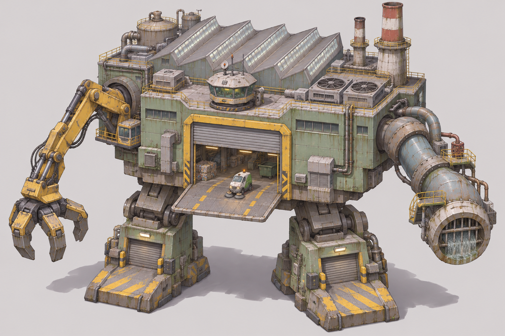

# 공장장 (가제)

중앙 AI가 인간을 말살하려 한다. 쓰레기 처리공장이 거대 로봇으로 변신해 맞선다.

탑다운 로그라이트 메카 액션 게임입니다. 갈림길에서 목적지를 골라 구역을 돌파하고, 전투에서 모은 고철로 스킬 모듈을 달아 마지막 구역의 보스를 쓰러뜨립니다.

**▶ 바로 플레이: https://sinmustard.github.io/r/**

## 플레이 방법

처음 `게임 시작`을 누르면 튜토리얼(안내 4장 + 연습 전투 8단계)부터 진행합니다. 이후에는 시작 화면 메뉴에서 튜토리얼을 다시 할 수 있습니다.

| 키 | 동작 |
| --- | --- |
| WASD | 이동 |
| 마우스 | 조준 |
| 좌클릭 | 집게팔 — 적 · 큐브 잡기, 다시 누르면 던지기 |
| 우클릭 | 오염 폐수 (누르고 있는 동안 발사) |
| Q / R | 청소 로봇 사출 / 회수 |
| E | 압축 지뢰 설치 |
| F | 고철 압축 (큐브) |
| Shift | 청소 가속화 |
| Space | 오버클럭 |
| Esc | 일시정지 |

### 한 판의 흐름

1. 갈림길에서 다음 목적지를 2~3개 중 하나 고릅니다 — 전투 · 정예 전투 · 정비 · 사건
2. 6칸을 지나면 구역 보스와 싸웁니다. 보스를 쓰러뜨리면 보상 모듈을 받고 다음 구역으로 갑니다.
3. 처음에는 **4구역 보스**가 최종 보스입니다. 누적 10회 클리어하면 **5구역 · 중앙 AI**가 열립니다.
4. 쓰러지거나 클리어하면 모듈과 고철은 초기화됩니다. 누적 클리어 횟수는 브라우저에 저장됩니다.

### 정비와 모듈

- 스킬 7개마다 카트리지가 하나씩 있고, 카트리지마다 모듈 슬롯이 4칸입니다.
- 정비 칸에서는 **추천 모듈**(할인) 또는 **지정 개발**(2배 가격)로 모듈 하나를 얻습니다.
- 전용 모듈은 첫 보스를 쓰러뜨린 뒤 열립니다.

## 실행하기

빌드나 설치가 필요 없습니다.

- 온라인: 위 링크
- 내 컴퓨터: 저장소를 받은 뒤 `index.html`을 브라우저로 엽니다.

`main` 브랜치에 올리면 GitHub Pages에 1~2분 뒤 반영됩니다. 새로고침하면 최신 코드가 바로 실행됩니다.

## 폴더 구조

| 경로 | 내용 |
| --- | --- |
| `index.html` | 시작 파일. `js/load.js`를 불러옵니다. |
| `js/load.js` | 나머지 스크립트와 `style.css`를 순서대로 불러옵니다. 새 js 파일은 여기 목록에 추가합니다. |
| `js/config.js` | 버전(`VERSION`)과 모든 수치(`CONFIG`) |
| `js/game.js` | 게임 루프 · 입력 · 본체 · 그리기 · 시작 화면 |
| `js/skills.js` | 스킬(큐브 · 지뢰 · 가속 · 오버클럭)과 전용 모듈 효과 |
| `js/modules.js` | 모듈 종류와 카트리지별 모듈 목록 |
| `js/upgrade.js` | 정비 · 보스 보상 화면 |
| `js/route.js` | 갈림길 · 사건 · 전투 시작과 끝 |
| `js/bosses.js` | 보스 5종의 패턴 · 페이즈 · 전환 연출 |
| `js/enemies.js` | 일반 적 13종의 행동과 그리기 |
| `js/tutorial.js` | 튜토리얼 |
| `assets/` | 게임에서 쓰는 그림 (`assets/bosses/game/`, `assets/enemies/game/`은 원본을 게임용으로 줄인 시트) |
| `concept-art/` | 콘셉트 아트 |
| `docs/` | 시스템 기획 문서와 참고 그림 |

## 문서

- [기획.md](기획.md) — 세계관 · 진행 · 전투 기술
- [docs/카트리지-시스템.md](docs/카트리지-시스템.md) — 모듈 · 카트리지 · 정비 화면
- [docs/적과-보스-패턴.md](docs/적과-보스-패턴.md) — 적 종류와 보스 패턴
- [docs/폐수-게이지.md](docs/폐수-게이지.md) — 오염 폐수 게이지
- [CHANGELOG.md](CHANGELOG.md) — 업데이트 내역

## 같이 만들기

사람과 AI(ChatGPT Codex · Claude)가 함께 작업합니다. 작업 전에 **[AGENTS.md](AGENTS.md)** 를 먼저 읽어 주세요.

- 기획 · 밸런스 · 큰 구조 변경은 저장소 주인(신율)이 정합니다.
- 질문 · 제안 · 자료 요청은 [GitHub 이슈](https://github.com/sinmustard/r/issues)로 남깁니다.
- 코드에는 주석을 넣지 않습니다. 설명은 커밋 메시지나 이슈에 적습니다.
- 커밋 메시지와 화면 글자는 한국어로 씁니다.
