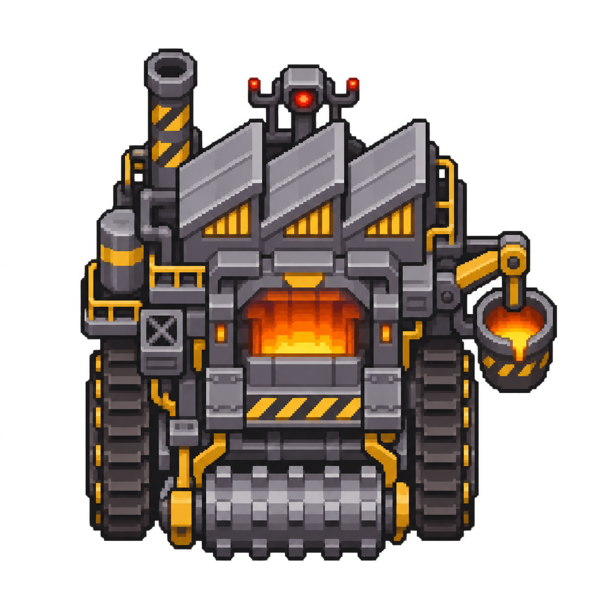
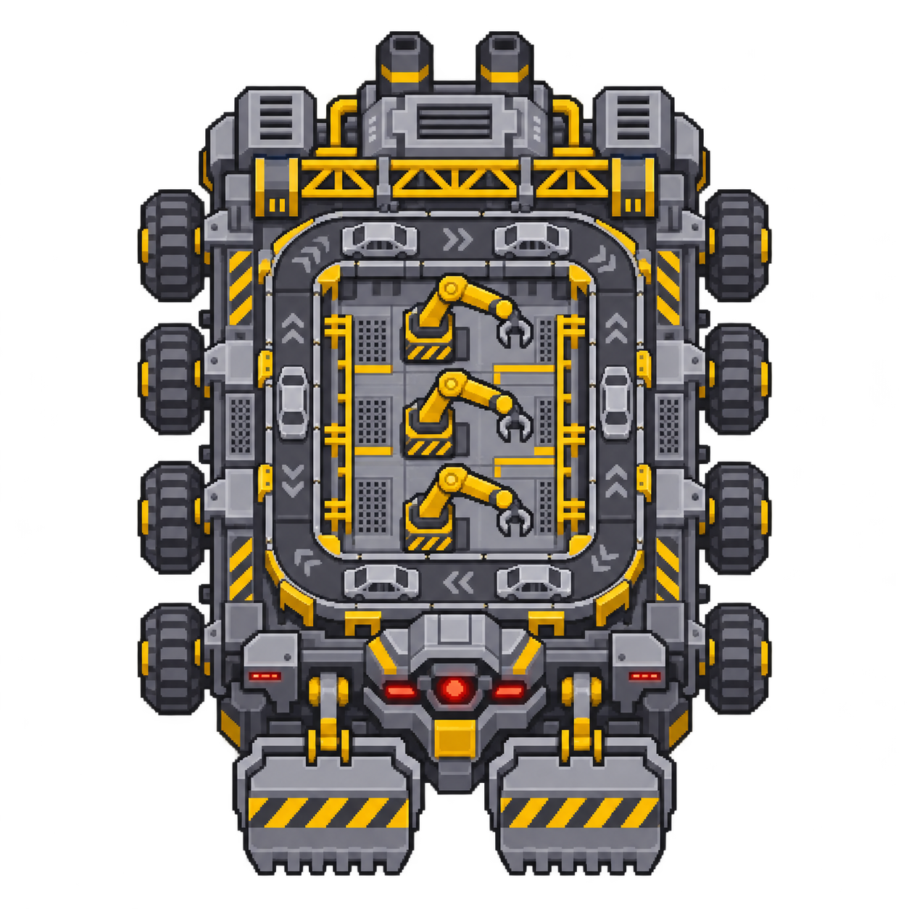
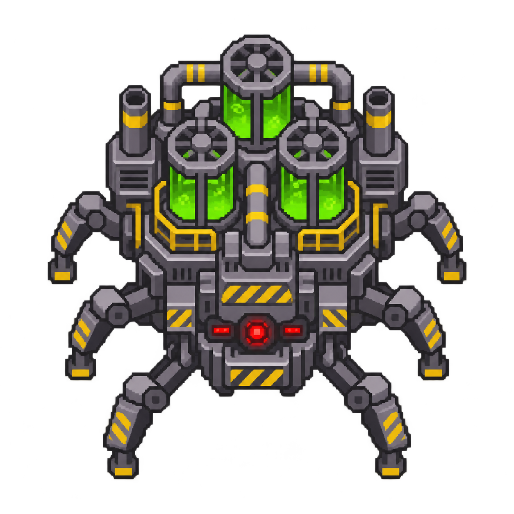
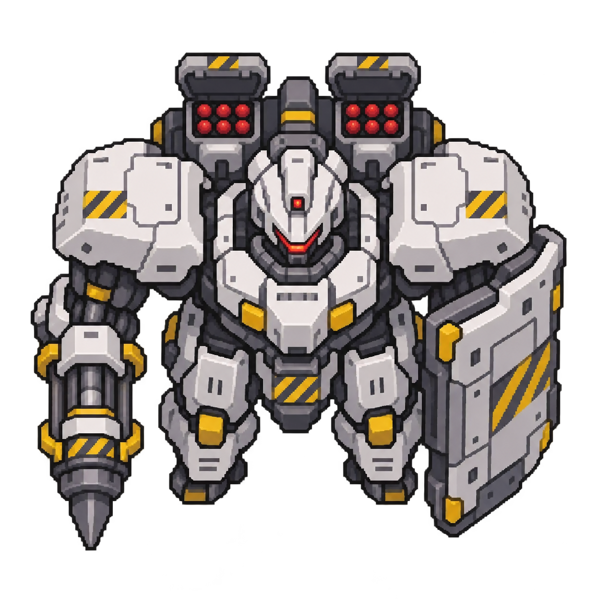
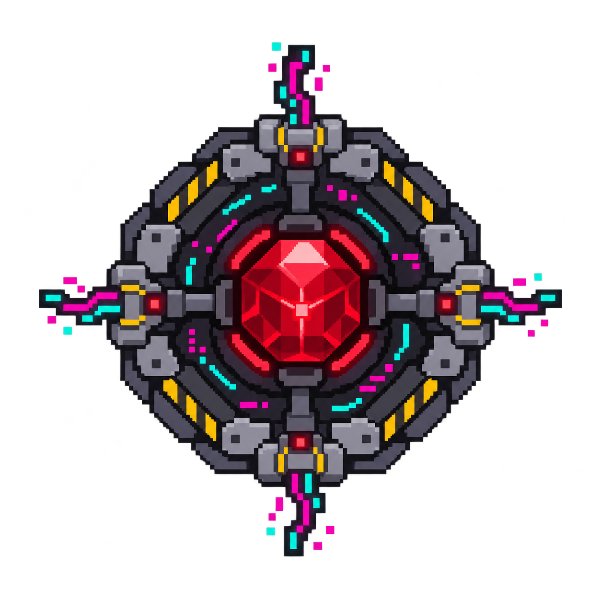

# 보스 대기 스프라이트

각 파일은 1프레임 PNG다. 투명 배경이며 화면 아래를 바라보는 자세로 그렸다. 게임에서 크기를 줄여 사용한다. 가장자리의 반투명 픽셀은 작은 크기에서 확인하고, 회전 시 화면의 원근감도 확인한다.

| 챕터 | 보스 | 파일 |
| --- | --- | --- |
| 1 | 철강공장 | [steel-factory.png](./steel-factory.png) |
| 2 | 자동차공장 | [auto-factory.png](./auto-factory.png) |
| 3 | 화학공장 | [chemical-factory.png](./chemical-factory.png) |
| 4 | 집행자 | [executioner.png](./executioner.png) |
| 5 | 중앙 AI | [central-ai.png](./central-ai.png) |

## 불러오기

HTML 게임의 루트 경로에서 불러온다. 원본 이미지의 중앙을 그리기 기준점으로 사용한다. 충돌 판정은 보스별 몸통 크기에 맞춰 별도로 지정한다.

```js
const bossImage = new Image();
bossImage.src = "assets/bosses/steel-factory.png";
bossImage.onload = () => {
  ctx.imageSmoothingEnabled = false;
  ctx.drawImage(bossImage, x - 128, y - 128, 256, 256);
};
```

원본의 정확한 픽셀 크기는 PNG 헤더 또는 Image.naturalWidth와 Image.naturalHeight로 읽는다. 투명 여백을 포함하므로 256은 시각적 테스트용 크기다.

## 미리보기







이번 자료는 대기 이미지다. 보행·공격·페이즈 변화 애니메이션과 실제 보스 코드 연결은 후속 작업이다. 집행자는 다른 보스보다 몸통 전면이 많이 보이는 시점이므로 실제 화면에서 크기와 각도를 맞춰 확인한다.
