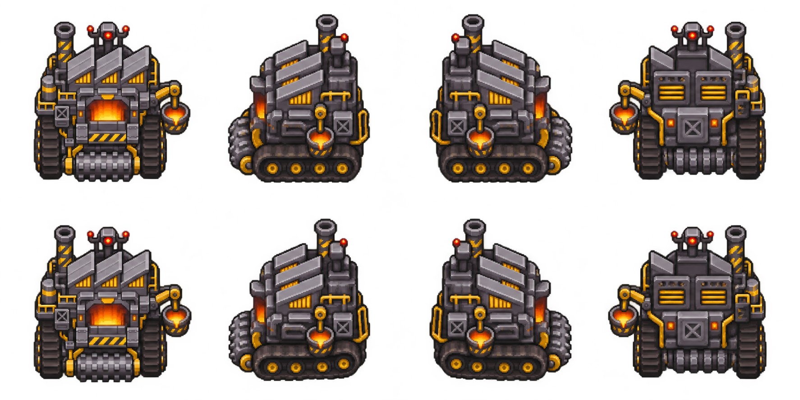
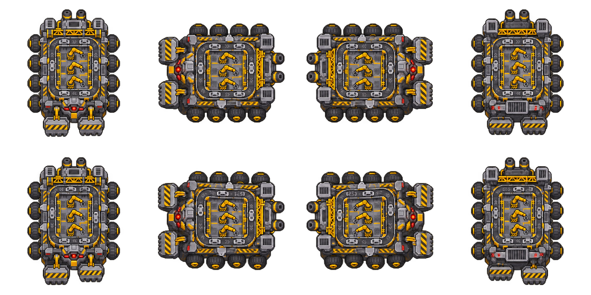
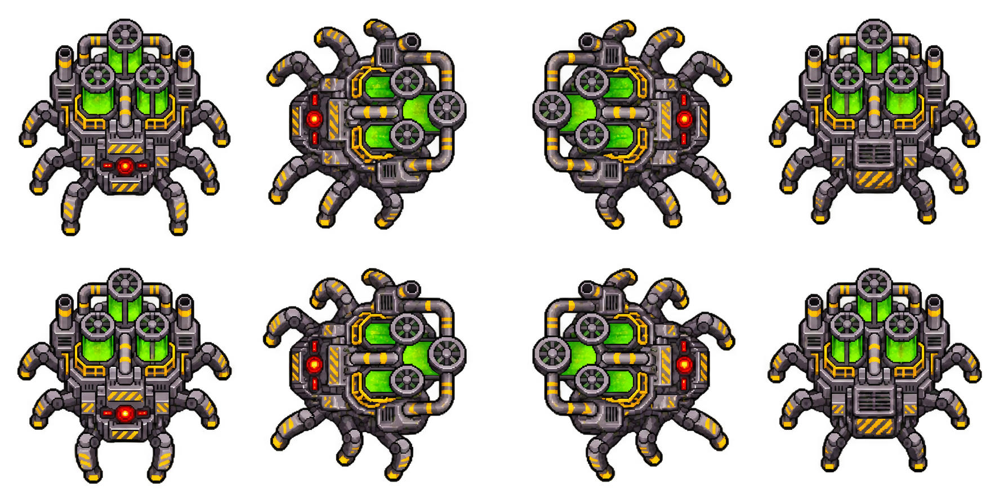
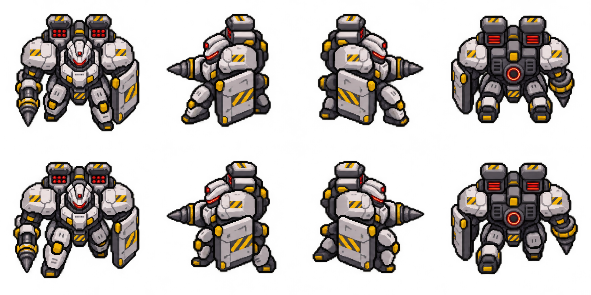
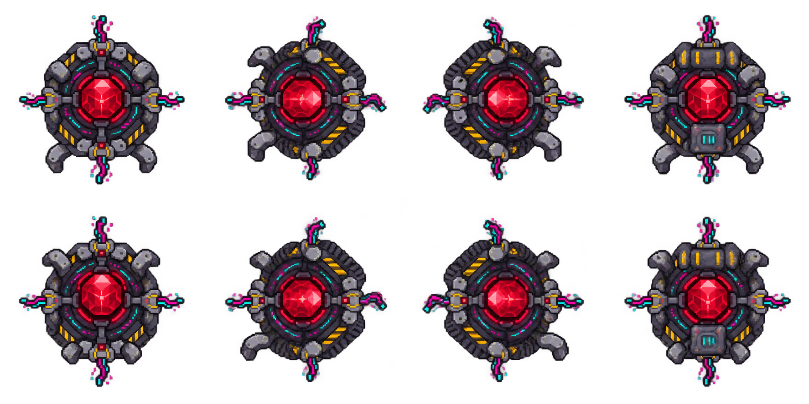

# 보스 상하좌우 이동 시트

5개 PNG에 각각 4열 × 2행, 총 8프레임이 있다. 열 순서는 아래·왼쪽·오른쪽·위이며 두 행은 동작 A와 B다. 중앙 AI는 부유 동작이다.

| 보스 | 파일 |
| --- | --- |
| 철강공장 | [steel-factory.png](./steel-factory.png) |
| 자동차공장 | [auto-factory.png](./auto-factory.png) |
| 화학공장 | [chemical-factory.png](./chemical-factory.png) |
| 집행자 | [executioner.png](./executioner.png) |
| 중앙 AI | [central-ai.png](./central-ai.png) |

각 파일은 이동용 초안이다. 프레임 간 부품과 비율이 조금씩 달라질 수 있으므로 재생 시 흔들림을 확인한다. 실제 게임 연결은 후속 작업이다.

이미지 크기가 4 또는 2로 나누어떨어지지 않을 수 있어 각 셀 경계를 다음처럼 계산한다.

```js
const sx = Math.round(col * image.naturalWidth / 4);
const sy = Math.round(row * image.naturalHeight / 2);
const sw = Math.round((col + 1) * image.naturalWidth / 4) - sx;
const sh = Math.round((row + 1) * image.naturalHeight / 2) - sy;
ctx.imageSmoothingEnabled = false;
ctx.drawImage(image, sx, sy, sw, sh, x - size / 2, y - size / 2, size, size);
```

이동할 때 0.18초마다 행을 번갈아 재생하고 정지 시 첫 행을 사용한다. 이는 재생 시작값이며 실제 이동 속도에 맞춰 조정한다.






