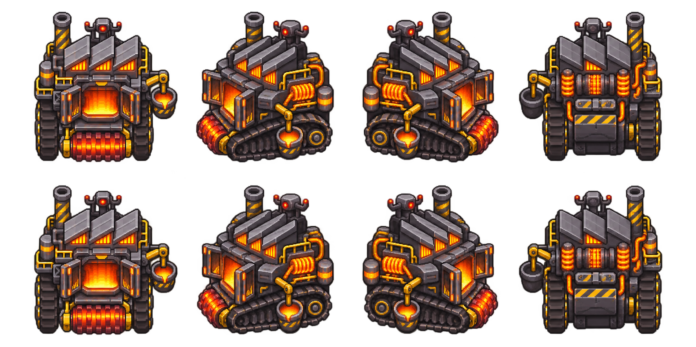
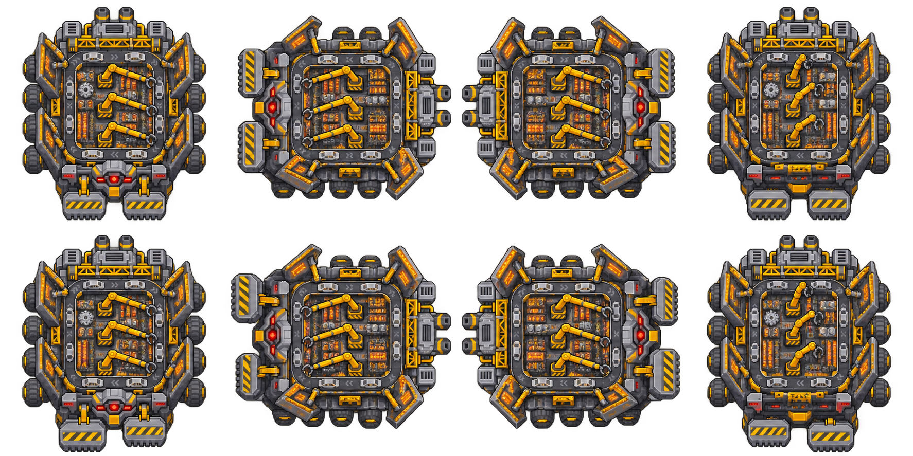
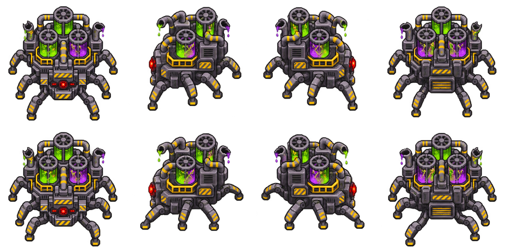
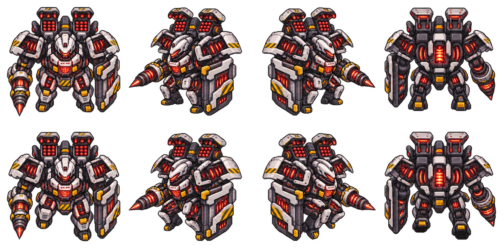
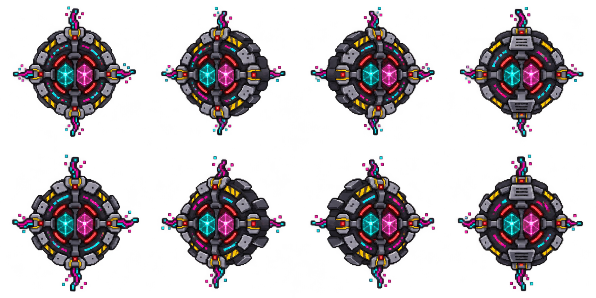

# 보스 2페이즈 이동 시트

각 PNG는 4열 × 2행이다. 열 순서는 아래·왼쪽·오른쪽·위이고, 두 행을 번갈아 이동 동작으로 재생한다. 원본 크기는 1774×887이다. 셀 경계는 이미지 크기를 기준으로 반올림해서 계산한다. [1페이즈 시트의 사용 설명](../README.md)을 참고한다.

| 보스 | 2페이즈 외형 |
| --- | --- |
| [철강공장](./steel-factory.png) | 열린 용광로와 달아오른 롤러 |
| [자동차공장](./auto-factory.png) | 열린 외벽과 드러난 조립 설비 |
| [화학공장](./chemical-factory.png) | 갈라진 탱크와 서로 다른 약품 |
| [집행자](./executioner.png) | 열린 장갑과 붉게 과열된 내부 장치 |
| [중앙 AI](./central-ai.png) | 분리된 디지털 코어와 복제 단계의 외형 |

이 자료는 이동용 시각 초안이다. 중앙 AI의 실제 복제 적은 게임 코드에서 별도 개체로 생성한다. 이 시트의 코어 분리 연출만으로 복제 패턴을 구현하지 않는다. 페이즈 변경에 맞춰 시트 경로를 교체한다.

1페이즈와 프레임별 몸체 크기·중심점에 차이가 있을 수 있으므로 게임 재생 시 정렬이 필요하다. 집행자의 측면은 비스듬한 모습으로 나와 방향 표현을 추가 조정할 수 있다. 공격·전환 애니메이션 및 중앙 AI 3페이즈는 별도 작업이다. 실제 게임 연결은 확인하지 않았다.

