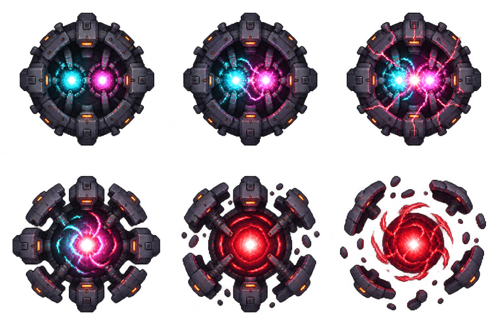
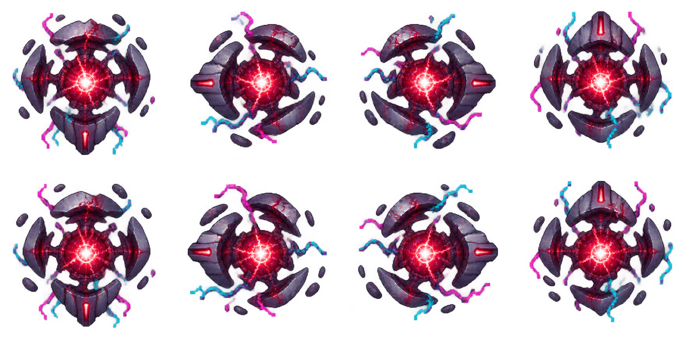

# 중앙 AI 3페이즈 시트

- [전환](./central-ai-transition.png) — 3열×2행 6프레임. 위 왼쪽부터 순서대로 재생한다. 복제 코어가 불안정해지고 장갑이 갈라져 붉은 코어가 드러난다.
- [이동](./central-ai-movement.png) — 4열×2행 8프레임. 열은 아래·왼쪽·오른쪽·위, 행은 부유 A·B다.

2→3페이즈도 중앙 이동, 아래 방향 고정, 카메라 강조, 전환 한 번 재생 후 복귀 규칙을 따른다. 전환은 프레임당 0.15초를 시작값으로 삼는다. 이동 시트는 0.18초마다 행을 교대하는 시작값을 제안한다.

PNG 실제 크기를 읽고 셀 경계를 반올림해 사용한다. 이 자료는 생성한 애니메이션 초안이며 기존 2페이즈와 외형 및 중심점 차이를 게임에서 보정해야 한다. 전환의 마지막 프레임과 이동 시트의 장갑 배치도 차이가 있으므로 연결 시 확인한다. 광택·반투명 효과는 어두운 바닥과 밝은 바닥에서 모두 확인한다. 게임 연결은 아직 확인하지 않았다.

