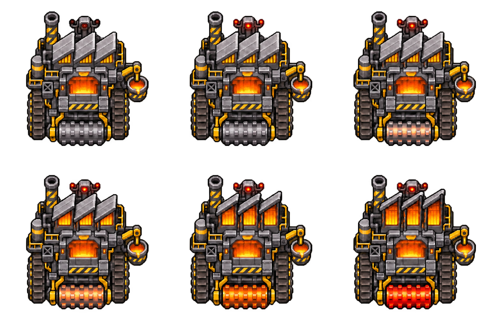
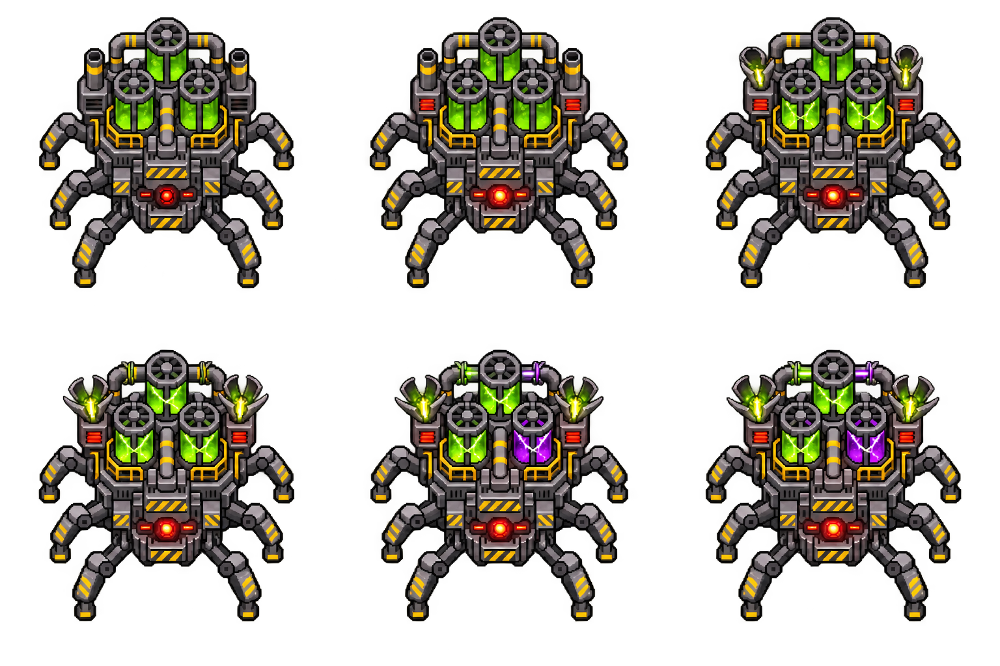
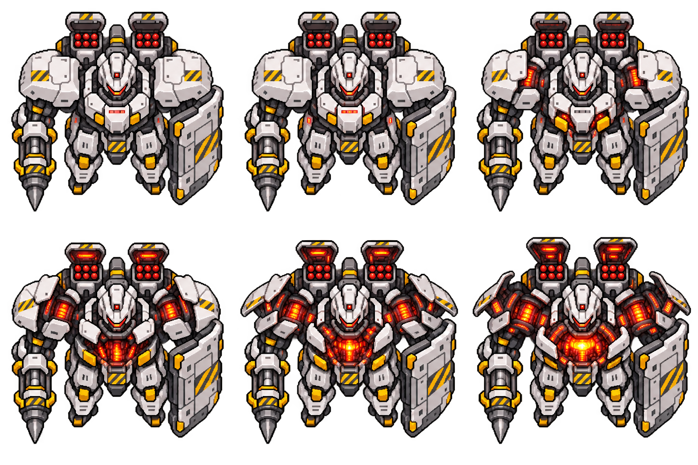

# 1→2페이즈 전환

5종 모두 3열×2행, 6프레임이다. 위 행 왼쪽부터 재생하고 아래 행으로 이어 간다. 바깥 모서리 알파 0을 확인했다. 기계 주변에는 반투명 발광 효과가 있다.

[재생 미리보기](./preview.html)를 브라우저에서 열어 보스를 선택한다. 다시 재생 버튼으로 반복 확인한다. frames.js는 셀 좌표와 불투명 실루엣 중심점을 담는다. 알파 128 이상 픽셀을 3픽셀 간격으로 측정해 그리기 오프셋을 계산했다. 같은 배율을 유지해 장갑이 펼쳐지는 변화가 보이게 한다.

## 중앙 전환 연출 규칙

1. 체력 조건을 만족하면 한 번만 전환 상태로 들어간다. 기존 공격과 위험 지대를 정리한다.
2. 보스를 전장 중앙으로 이동시켜 아래를 바라보게 한다.
3. 조작과 적 공격을 잠시 멈추고 보스는 전환 중 피해를 받지 않는다.
4. 카메라를 보스 중심으로 확대하고 프레임당 0.15초로 한 번 재생한다.
5. 2페이즈 이동 시트의 아래 방향으로 바꾼 뒤 카메라를 복귀한다.
6. 전투를 재개한다. 중앙 AI 복제와 회복은 전환당 한 번만 처리한다.

이번 자료는 이미지, 보정 좌표 및 독립 재생 예제다. 메인 게임의 중앙 이동과 카메라 연출 연결은 후속 작업이다. 프레임 사이 부품 형태와 다음 이동 시트로 넘어갈 때의 외형 차이는 추가 조정이 필요할 수 있다. 중앙 AI는 배경 정리를 위해 단순화한 외형으로 다시 생성했다.

