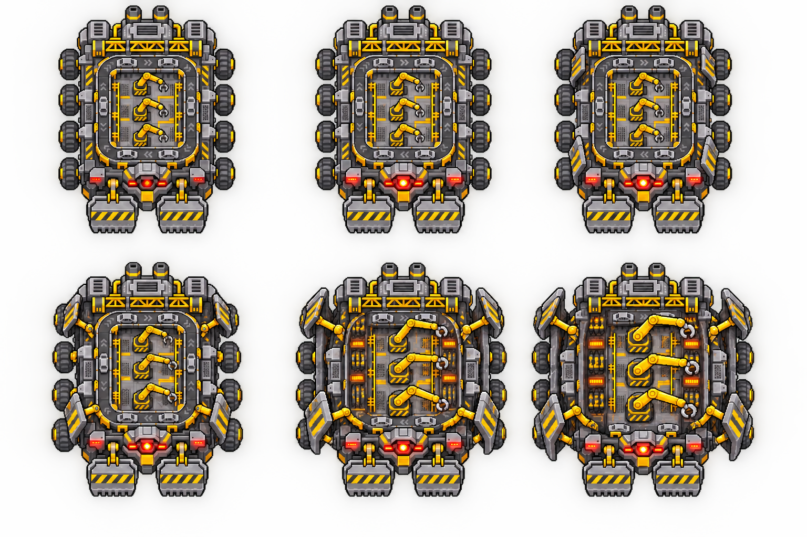
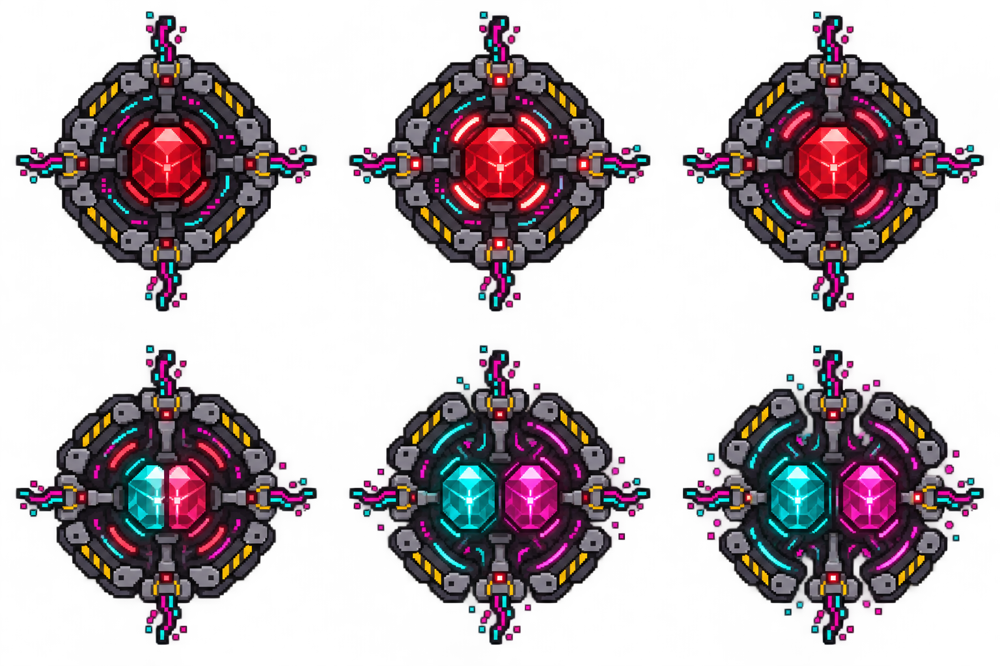

# 1→2페이즈 전환 연출 초안

각 PNG는 3열×2행, 6프레임이다. 위 행 왼쪽부터 오른쪽, 아래 행 왼쪽부터 오른쪽으로 한 번 재생한다. 전환 시간 초안은 프레임당 0.15초, 총 0.9초다. 완료 후 2페이즈 이동 시트로 전환한다.

- 철강공장 — 경고등이 켜지고 롤러가 달아오른다.
- 자동차공장 — 외벽과 조립팔을 펼친다.
- 화학공장 — 탱크에 금이 가고 약품 색이 변한다.
- 집행자 — 장갑을 열고 붉은 내부 장치가 드러난다.
- 중앙 AI — 붉은 코어가 두 디지털 코어로 분리된다.

이 파일은 전환 동작 참고용 초안이다. 배경 색과 광택이 남아 있어 그대로 겹치면 직사각형 배경이 보일 수 있다. 투명 배경 정리와 프레임 중심점·배율 맞춤 후 게임용으로 사용한다. 2페이즈 이동 시트의 최종 외형과도 맞춰야 한다. 전환 방향은 화면 아래 기준 한 방향이다. 전환 중 피해 처리와 공격 정지는 보스 코드에서 정한다. 중앙 AI의 회복과 복제 적 생성도 코드에서 처리한다.

