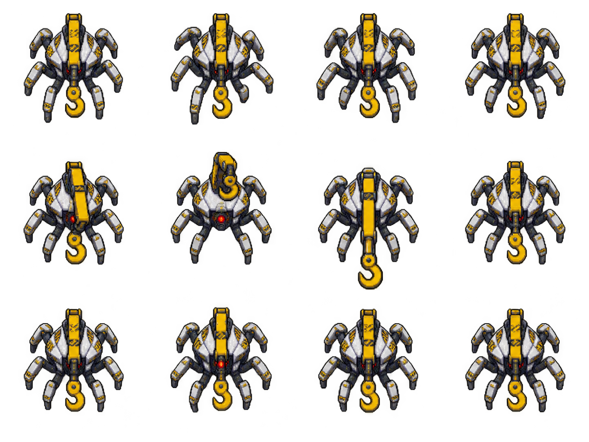
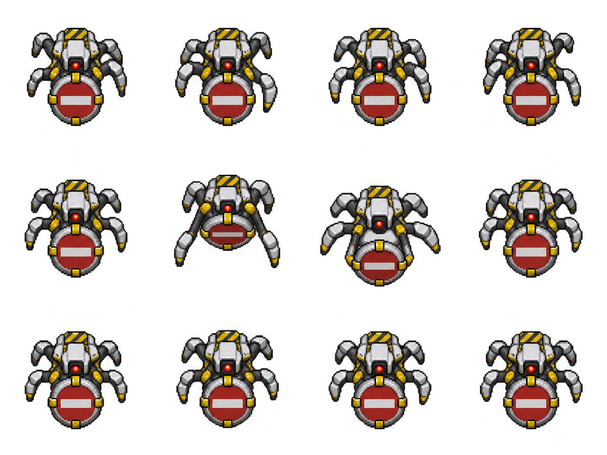
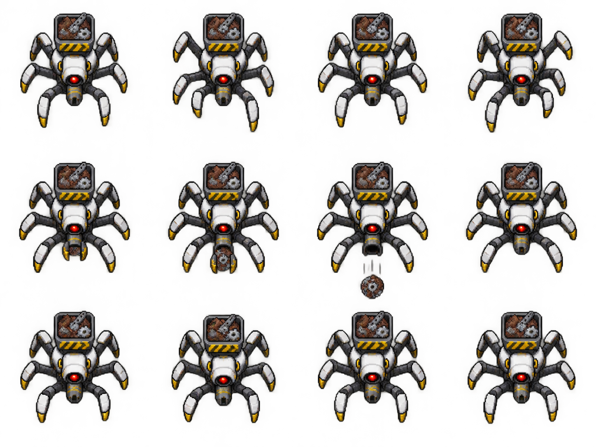

# 기본 적 애니메이션 3종

| 파일 | 적 | 공격 |
| --- | --- | --- |
| [hook-bot.png](./hook-bot.png) | 견인봇 | 갈고리를 뒤로 당겨 예고한 뒤 앞으로 뻗는다. 본체 돌진은 이동 코드로 구현한다. |
| [shield-bot.png](./shield-bot.png) | 차단봇 | 표지판을 들어 예고한 뒤 내려찍는다. |
| [scrap-bot.png](./scrap-bot.png) | 고철 투사봇 | 고철을 장전하고 발사한 뒤 재장전한다. |

각 시트는 4열×3행이다. 첫 행은 보행 4프레임 반복, 둘째 행은 공격 4프레임 한 번, 셋째 행은 대기 4프레임 반복이다. 기본 방향은 화면 아래다. 상하좌우 별도 시트는 아직 없다. 회전 렌더링을 사용할 경우 원근감과 공격 방향을 실제 화면에서 확인한다.

셀 경계는 naturalWidth/4, naturalHeight/3 기준으로 반올림한다. 크기가 정수로 나누어떨어지지 않을 수 있다. 보행은 프레임당 0.12초, 대기는 0.25초를 시작값으로 사용한다. 공격은 예고 두 프레임 → 세 번째 타격 프레임 → 회수로 연결한다. 실제 판정과 투사체는 게임 코드가 생성한다. 시트에 포함된 발사 고철은 연출로만 취급하고 실제 투사체와 중복 표시하지 않는다.

원본 PNG의 크기와 모서리 알파를 확인했다. 생성 시트 특성상 다리·장비가 프레임마다 조금 달라지고 반투명 테두리가 남을 수 있다. 게임에 연결하기 전 프레임 중심점과 축소 시 가독성을 확인한다. 현재 자료는 애니메이션 초안이며 게임 연결은 아직 확인하지 않았다.

상세 전투 규칙은 [적 패턴 문서](../../../docs/적과-보스-패턴.md)를 따른다.

