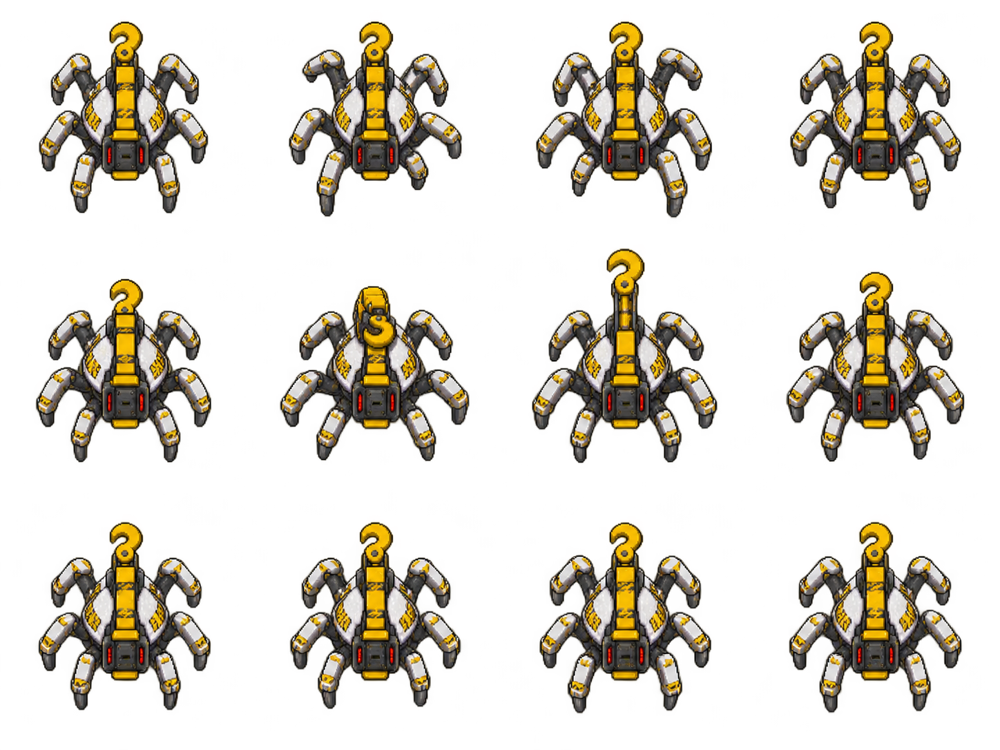
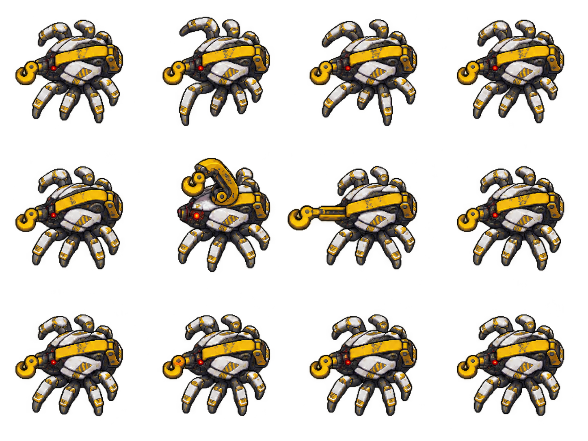
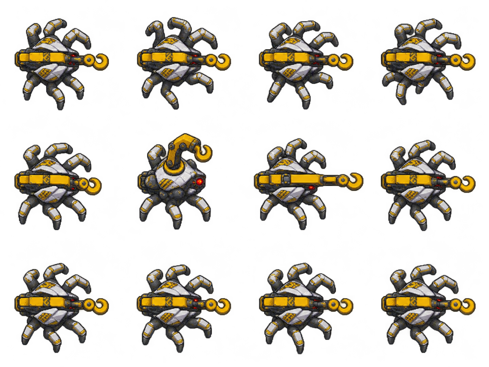
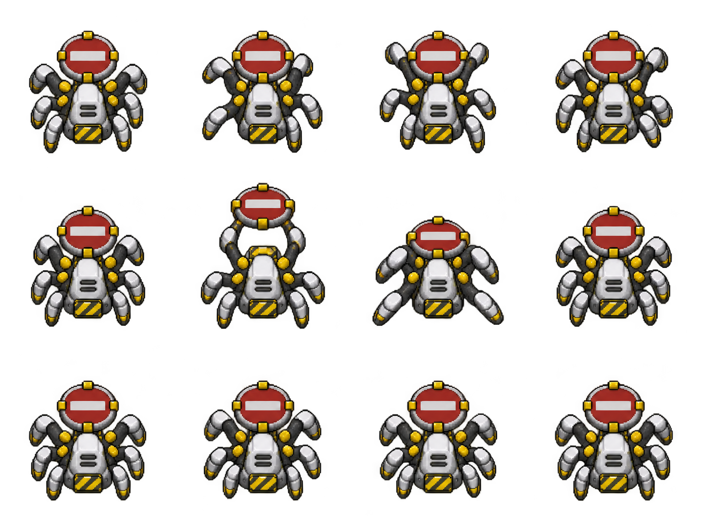
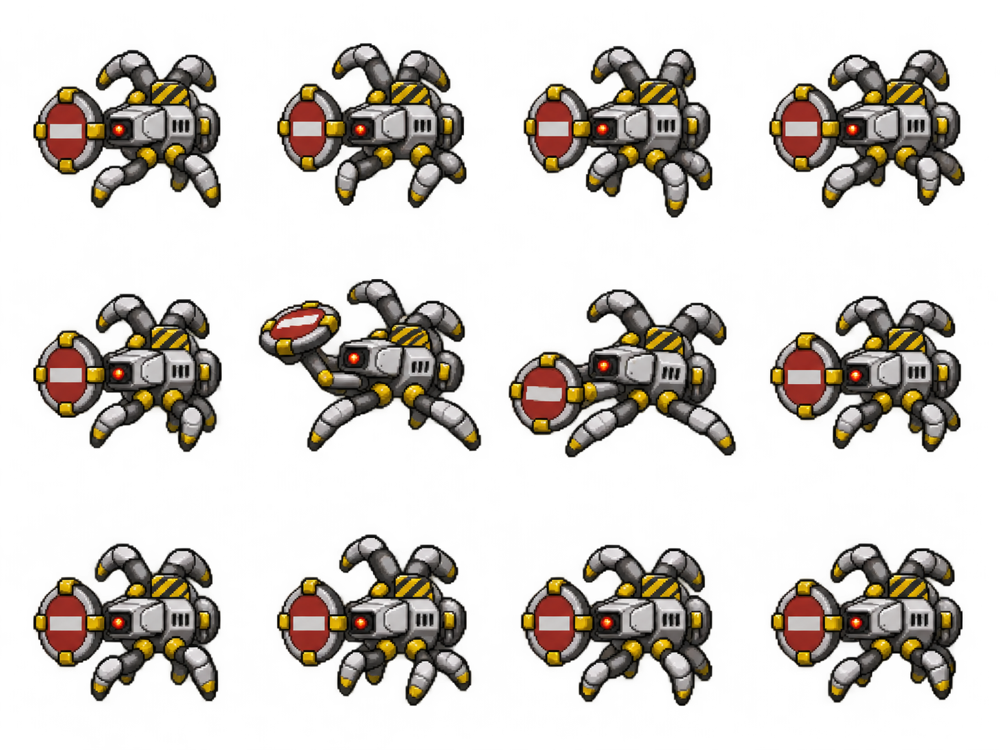
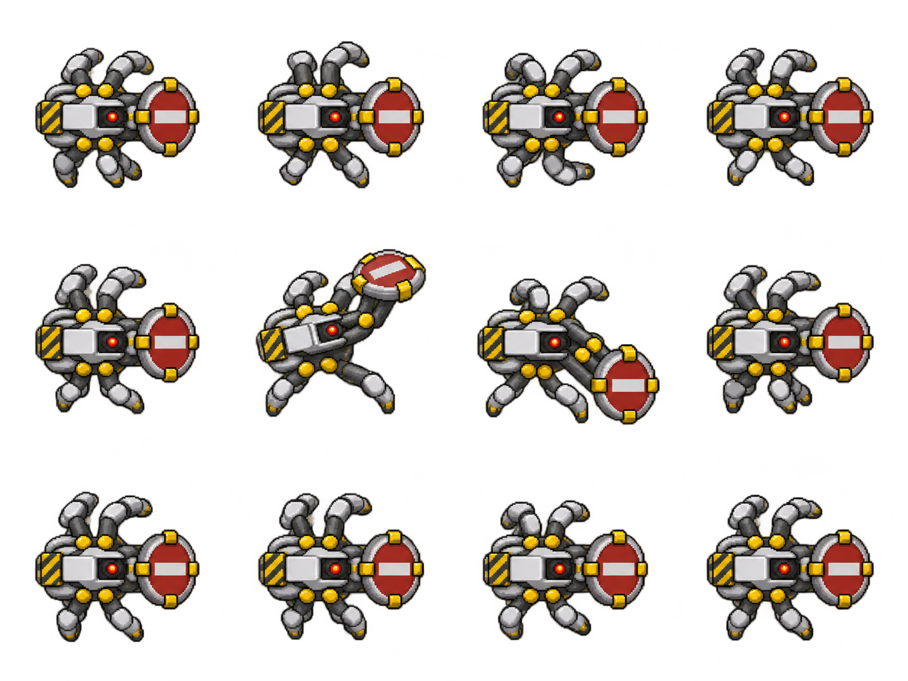
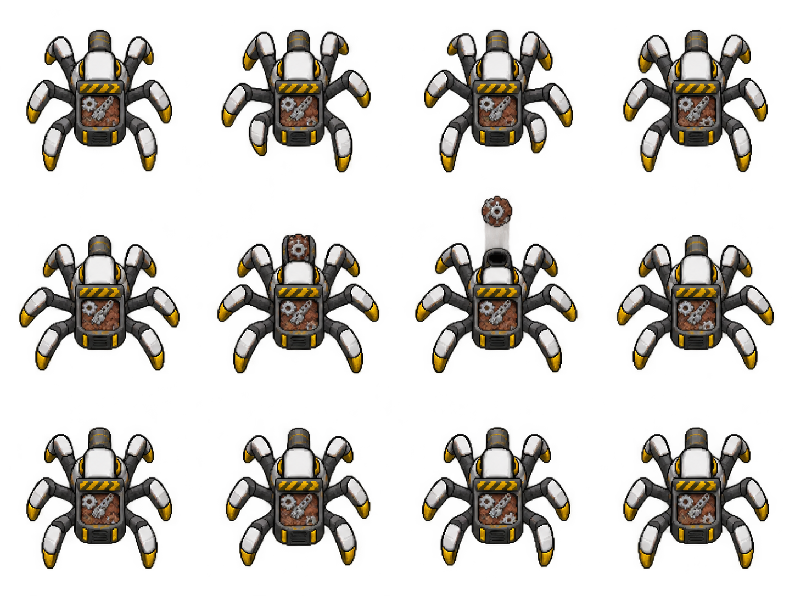
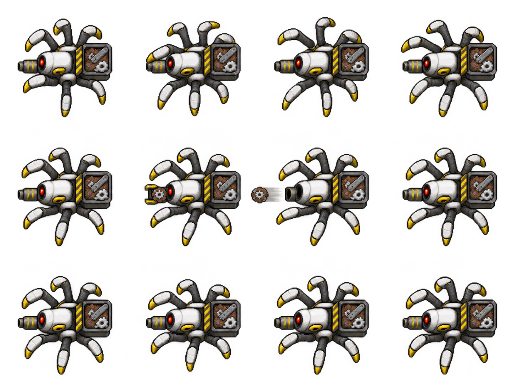
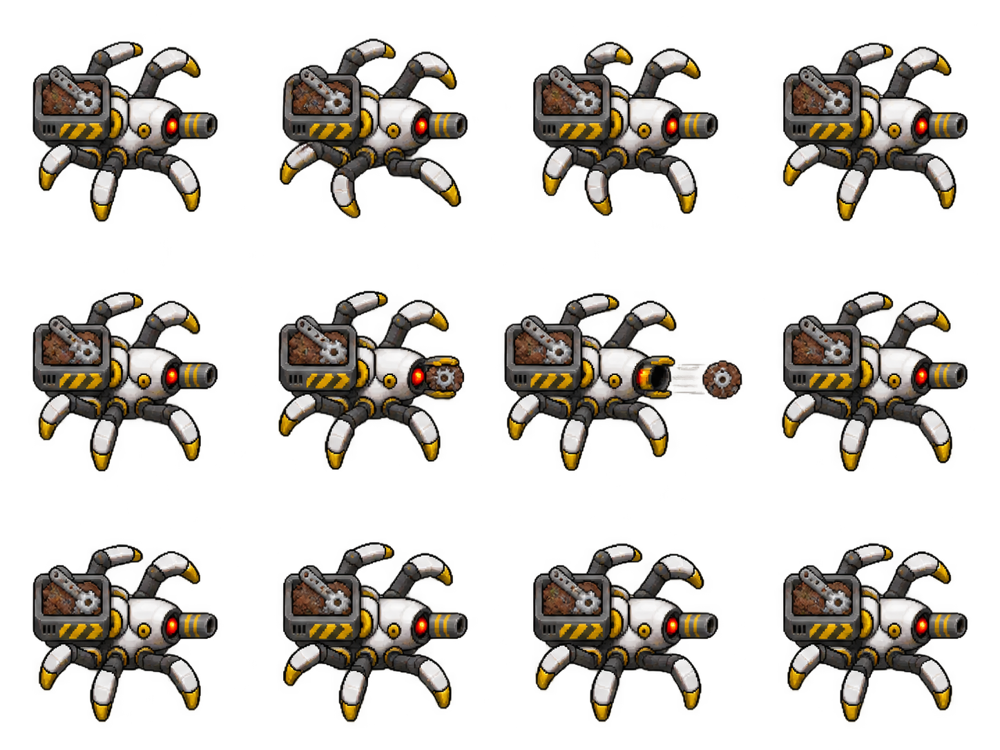

# 기본 적 3종 추가 방향 시트

각 적에 위·왼쪽·오른쪽 방향을 추가했다. 아래 방향은 상위 폴더의 기존 PNG를 사용한다. 파일 이름은 적 이름 뒤에 -up, -left, -right가 붙는다.

| 적 | 위 | 왼쪽 | 오른쪽 | 아래 |
| --- | --- | --- | --- | --- |
| 견인봇 | [up](./hook-bot-up.png) | [left](./hook-bot-left.png) | [right](./hook-bot-right.png) | [down](../hook-bot.png) |
| 차단봇 | [up](./shield-bot-up.png) | [left](./shield-bot-left.png) | [right](./shield-bot-right.png) | [down](../shield-bot.png) |
| 고철 투사봇 | [up](./scrap-bot-up.png) | [left](./scrap-bot-left.png) | [right](./scrap-bot-right.png) | [down](../scrap-bot.png) |

각 PNG는 1448×1086이며 4열×3행이다. 첫 행 보행, 둘째 행 공격, 셋째 행 대기이며 행마다 4프레임이다. 셀은 362×362다.

보행·대기는 반복 재생하고 공격은 한 번 재생한다. 방향을 선택한 뒤 시트를 추가로 90도 회전하지 않는다. 대각선 이동에서는 이동량의 절댓값이 큰 축을 기준으로 방향을 선택한다. 공격 준비가 시작되면 해당 공격이 끝날 때까지 공격 방향을 유지한다.

시트는 방향별 애니메이션 초안이다. 프레임 간 다리·장비 크기와 원근감 차이가 있어 게임 연결 시 중심점과 배율 확인이 필요하다. 차단봇 위 방향의 표지판 뒷면은 정면과 같은 표시로 표현되어 있으며 외형 조정 대상으로 남긴다. 투사체는 별도 개체로 처리하고 시트의 발사 표현과 중복하지 않게 한다. 게임 적용은 아직 확인하지 않았다.

