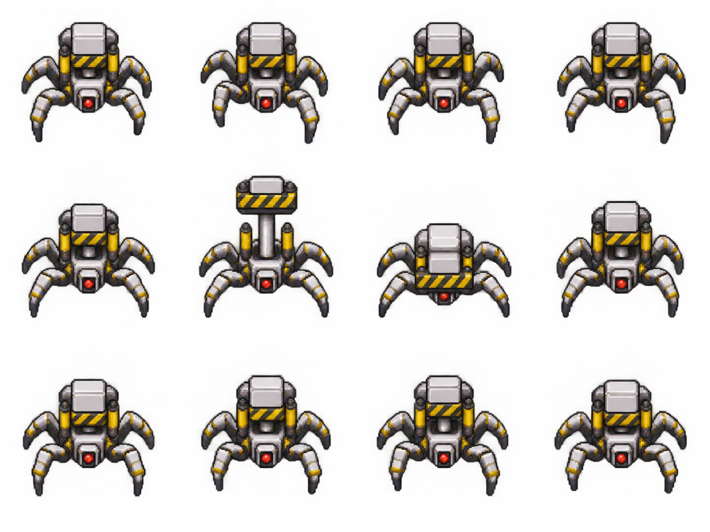
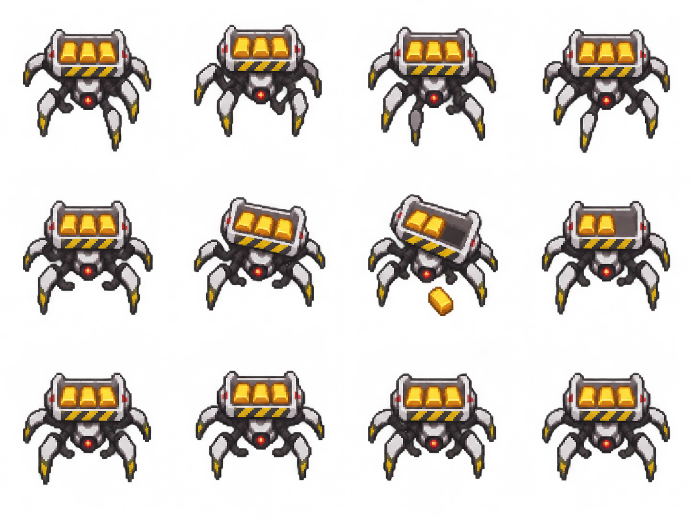
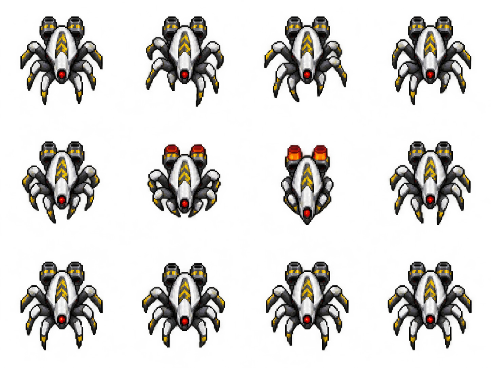
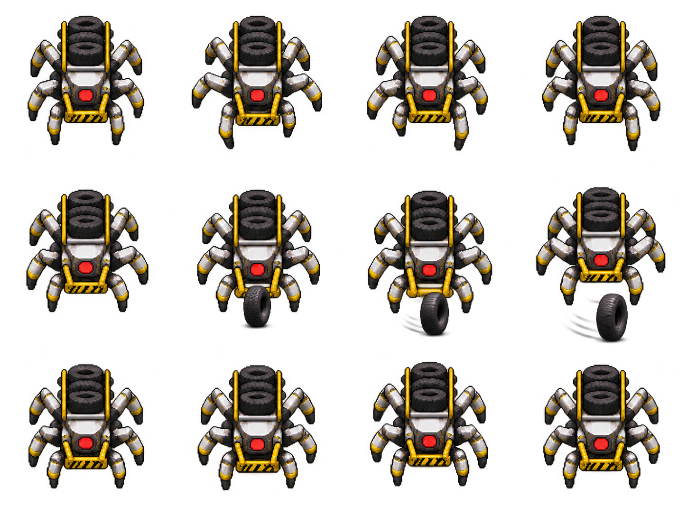
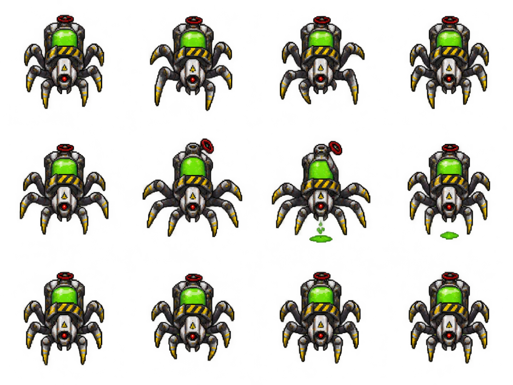
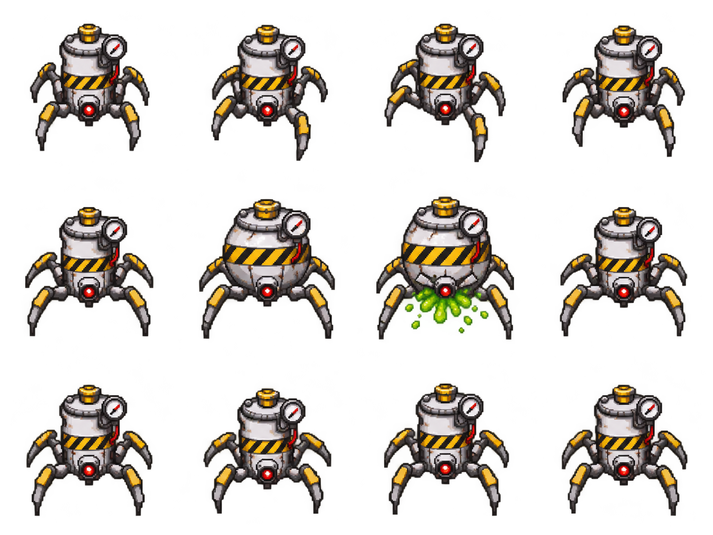
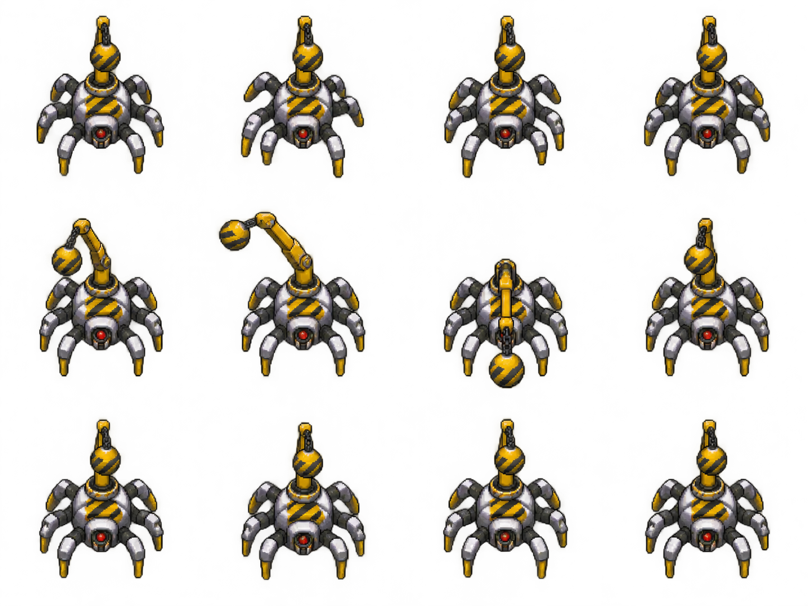
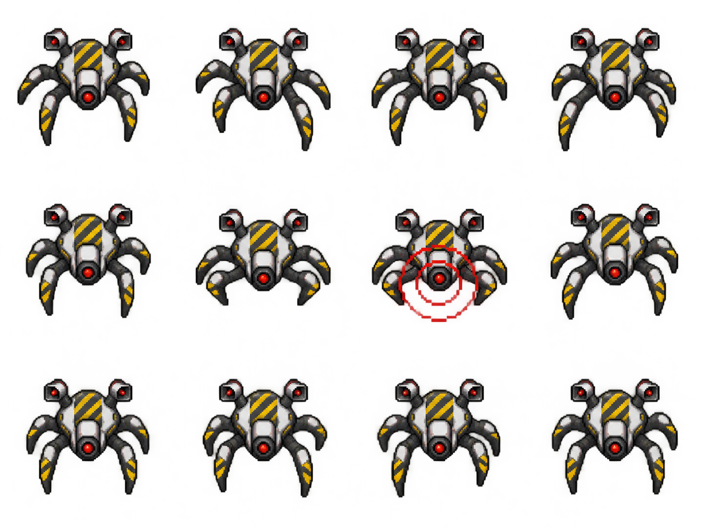
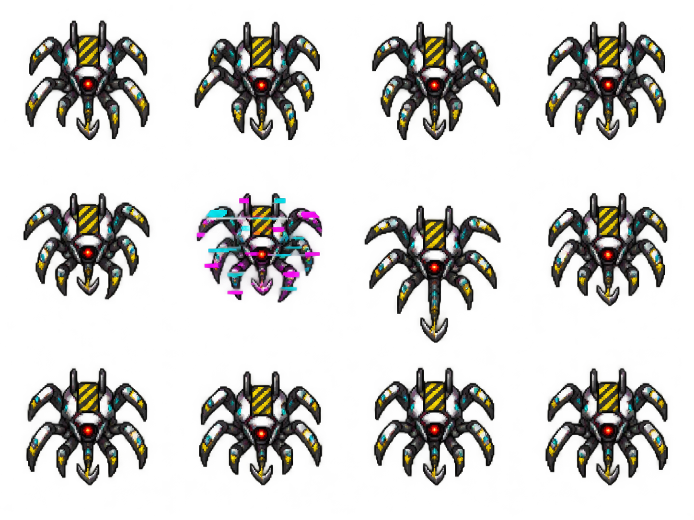
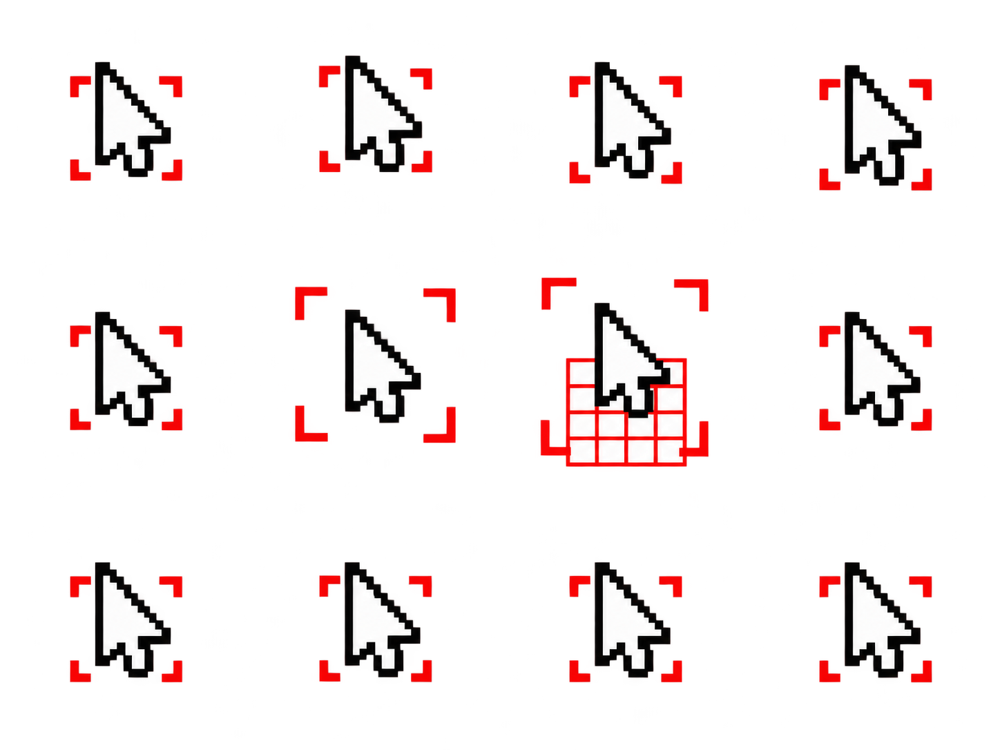

# 챕터 전용 적 애니메이션 10종

각 시트는 1448×1086, 4열×3행이다. 첫 행은 보행 4프레임, 둘째 행은 공격 4프레임, 셋째 행은 대기 4프레임이다. 기본 방향은 아래다. 삭제 커서는 부유 동작이다.

| 챕터 | 파일 | 공격 동작 |
| --- | --- | --- |
| 1 | [stamp-bot.png](./stamp-bot.png) | 프레스를 들었다가 내려찍음 |
| 1 | [ingot-bot.png](./ingot-bot.png) | 적재함을 기울여 뜨거운 철을 쏟음 |
| 2 | [dash-bot.png](./dash-bot.png) | 추진기를 예열하고 다리를 접어 돌진 |
| 2 | [tire-bot.png](./tire-bot.png) | 타이어를 세워 바닥에 놓고 밀어 굴림 |
| 3 | [leak-bot.png](./leak-bot.png) | 밸브를 열어 약품을 누출 |
| 3 | [barrel-bot.png](./barrel-bot.png) | 압력이 오르다가 폭발 |
| 4 | [demolition-bot.png](./demolition-bot.png) | 철거추를 당겼다가 앞으로 휘두름 |
| 4 | [relay-bot.png](./relay-bot.png) | 작은 확성기 두 개로 전자 신호 발신 |
| 5 | [glitch-bot.png](./glitch-bot.png) | 디지털 점멸 뒤 갈고리 공격 |
| 5 | [delete-cursor.png](./delete-cursor.png) | 선택 범위를 넓히고 삭제 격자 표시 |

보행과 대기는 반복하고 공격은 한 번 재생한다. 공격 줄의 세 번째 프레임이 타격·투척 시점의 시각 기준이다. 실제 예고 시간과 재사용 시간은 기존 적 코드 설정을 따른다. 투사체와 바닥 위험은 코드에서 별도 개체로 생성한다. 시트에 그려진 투사체와 실제 개체를 동시에 겹쳐 그리지 않도록 전환 시점을 맞춘다.

반응통봇은 폭발 후 사라지는 적이므로 세 번째 공격 프레임 이후 적 본체를 제거하고 폭발 효과만 남긴다. 네 번째 공격 프레임의 정상 몸체로 되돌리지 않는다.

시트는 애니메이션 초안이다. 상하좌우 별도 방향은 아직 없고, 프레임마다 부품·크기 차이가 있을 수 있다. 투명 영역에 남은 반투명 테두리와 입자는 실제 축소 화면에서 확인한다. 프레스 시트 위쪽의 밝은 잔여 입자는 적용 전 추가 정리가 필요하다. 게임 연결과 실제 재생은 아직 확인하지 않았다.

패턴은 [적과 보스 패턴](../../../docs/적과-보스-패턴.md)을 따른다.

