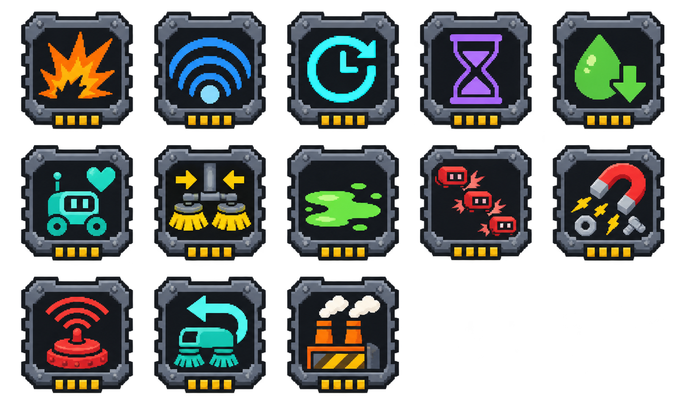
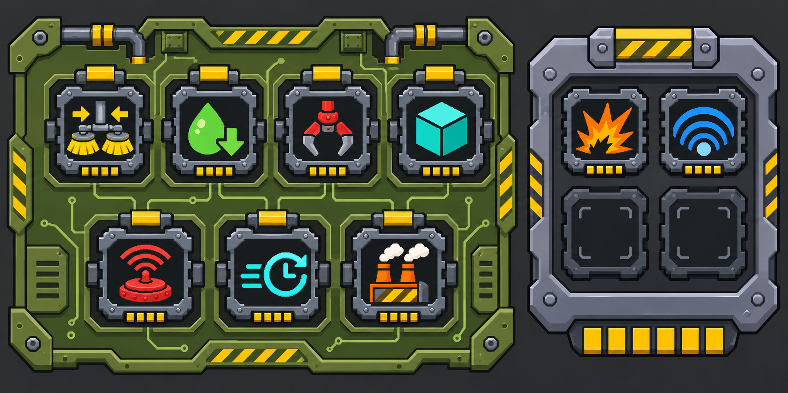
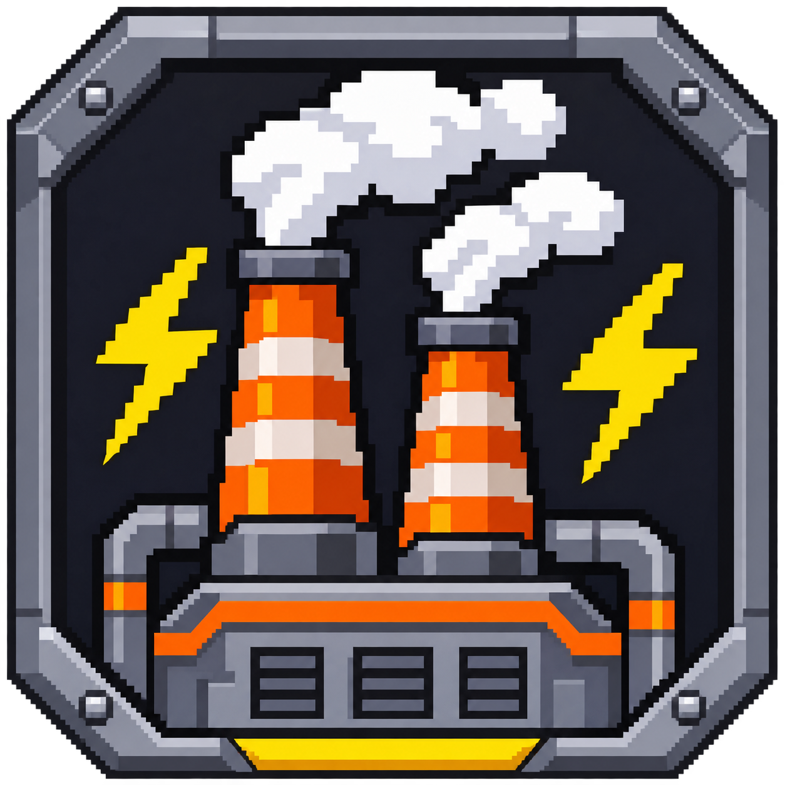

# 스킬 카트리지와 모듈

이 문서는 카트리지 시스템의 목표 사양이다. 아래 규칙과 수치는 재구현할 때 적용한다. 현재 게임 코드의 구현 상태와는 차이가 있을 수 있다.

## 개발과 장착

기본 스킬 7개와 전용 카트리지 7개는 새 판부터 사용할 수 있다. 카트리지당 슬롯은 4칸이며 모듈 하나가 한 칸을 사용한다. 같은 카트리지에는 같은 유형을 하나만 장착한다. 서로 다른 카트리지는 같은 유형을 각각 사용할 수 있다. 모듈 효과는 해당 스킬에만 적용된다.

전투와 사건에서 얻은 고철로 강화 구역에서 모듈을 개발한다. 청소 로봇이 운반하는 고철은 회수한 뒤 사용할 수 있다. 개발하면 선택한 스킬의 빈칸에 즉시 장착한다. 별도 보관함은 없다.

기본 모듈은 고철 6개, 전용 모듈은 12개다. 강화 구역에서 제거하면 실제 지불한 비용의 절반을 내림해서 반환한다. 교체는 제거 후 새 모듈을 개발하는 방식이다. 모듈 등급과 반복 강화 단계는 없다.

새 판은 모든 슬롯이 빈 상태로 시작한다. 구역을 넘어가면 모듈과 고철이 유지되고, 사망 또는 최종 보스 격파로 판이 끝나면 초기화한다. 누적 클리어 횟수는 유지한다.

## 일반 모듈 12종

기존 6종에 공격 속도, 소환체 이동속도, 운반량, 밀쳐내기, 감속, 보호막을 추가한다. 각 유형은 슬롯 한 칸을 사용한다.

| 유형 | 효과 |
| --- | --- |
| 데미지 | 적용 공격의 피해량 ×1.35 |
| 범위 | 적용 거리와 반경 ×1.30 |
| 쿨타임 | 재사용 대기시간 ×0.70. 폐수는 완충 시간 15초 → 10.5초 |
| 지속시간 | 적용 효과의 유지 시간 ×1.40 |
| 소모량 감소 | 폐수 게이지 또는 큐브·지뢰 제작 고철 소모 ×0.70 |
| 소환체 체력 증가 | 청소 로봇 최대 체력 ×1.60 |
| 공격 속도 | 청소 로봇 기본 공격 간격 ×0.80 |
| 소환체 이동속도 | 청소 로봇의 전투·수거·회수 이동속도 ×1.25 |
| 운반량 | 청소 로봇 고철 운반 한도 +3개 |
| 밀쳐내기 | 해당 공격이 발생시키는 밀림 거리 ×1.50 |
| 감속 | 집게팔 충돌 또는 지뢰 폭발에 맞은 적의 이동속도를 2초간 25% 감소 |
| 보호막 | 오버클럭 발동 시 본체 기본 최대 체력의 15%만큼 보호막 생성. 강화 종료 시 소멸 |

감속은 피해를 입은 적에게 적용하며 보스도 적용한다. 반복해서 맞으면 2초로 갱신하고 감속률은 누적하지 않는다. 여러 감속이 겹치면 가장 강한 하나를 적용한다. 보호막은 체력보다 먼저 피해를 흡수하며 중복해서 쌓이지 않는다. 밀쳐내기 면역인 보스는 면역을 유지한다.

## 스킬별 제공 유형

아래 유형에 각 스킬의 전용 모듈을 더해 개발 목록을 구성한다. 모든 유형을 모든 스킬에 제공하지 않는다.

| 카트리지 | 일반 모듈 | 적용 대상 |
| --- | --- | --- |
| 청소 로봇 사출 | 데미지, 범위, 쿨타임, 소환체 체력 증가, 공격 속도, 소환체 이동속도, 운반량 | 공격 피해, 탐색·공격 범위, 사출 대기시간, 로봇 체력, 기본 공격 간격, 이동속도, 운반 한도 |
| 오염 폐수 방출 | 데미지, 범위, 쿨타임, 소모량 감소, 밀쳐내기 | 초당 피해, 물줄기 길이·폭, 충전 시간, 초당 게이지 소모, 물줄기의 밀림 거리 |
| 집게팔 | 데미지, 범위, 쿨타임, 지속시간, 밀쳐내기, 감속 | 투척 충돌 피해, 잡기 거리·충돌 반경, 재사용 대기시간, 충돌 기절 시간, 충돌 밀림 거리, 충돌 감속 |
| 고철 압축 | 데미지, 쿨타임, 지속시간, 소모량 감소 | 큐브 투척 피해, 제작 대기시간, 큐브 유지 시간, 제작 고철 |
| 압축 지뢰 | 데미지, 범위, 쿨타임, 소모량 감소, 감속 | 폭발 피해, 폭발 반경, 설치 대기시간, 제작 고철, 폭발 감속 |
| 청소 가속화 | 데미지, 쿨타임, 지속시간, 공격 속도, 소환체 이동속도 | 가속 중 로봇 피해, 재사용 대기시간, 가속 유지 시간, 가속 중 로봇 기본 공격 간격·이동속도 |
| 오버클럭 | 쿨타임, 지속시간, 보호막 | 재사용 대기시간, 강화 유지 시간, 발동 보호막 |

고철 소모는 계산 후 올림한다. 예를 들어 5개 ×0.70은 4개다. 소모량 감소는 모듈 개발 비용에는 적용하지 않는다. 폐수는 기본 완충량으로 3초 발사하고 소모량 감소 장착 시 약 4.3초 발사한다. 지속시간은 큐브 체력이나 오버클럭 종료 후 출력 저하 3초를 바꾸지 않는다.

## 전용 모듈 7종

| 카트리지 | 전용 모듈과 동작 |
| --- | --- |
| 청소 로봇 사출 | **융합 세척기** — 기본 로봇 두 대의 몸체가 닿으면 융합한다. 공격력은 기본의 2배, 최대 체력과 현재 체력 및 운반 고철은 두 대의 합이다. 운반 한도도 합산한다. 추가 융합은 불가하고 소환 한도에서 두 대로 센다. 적이 앞에 2대 이상 모이면 0.6초 간격으로 회전 솔 광역 공격을 한다. 반경은 기본 공격 범위의 2배, 피해는 기본 공격 1회와 같다. |
| 오염 폐수 방출 | **잔류 오염** — 물줄기가 닿은 바닥에 2.5초간 웅덩이가 남는다. 밟은 적의 이동속도는 50% 감소한다. 웅덩이는 서로 피해나 감속을 중첩하지 않는다. |
| 집게팔 | **연쇄 충돌** — 던진 적에 맞은 적도 밀려나 추가 충돌을 일으킨다. 최초 충돌 뒤 최대 두 번 이어지고, 각 피해는 직전의 60%다. 같은 투척에서 같은 적을 중복 타격하지 않는다. 보스는 피해만 받는다. |
| 고철 압축 | **고철 흡수** — 큐브 제작 성공 시 평소 본체 줍기 반경의 3배 안에 있는 고철을 흡수한다. 제작 비용을 먼저 지불해야 한다. |
| 압축 지뢰 | **예약 기폭** — 설치 키를 0.4초 미만 누르면 놓을 때 설치하고, 0.4초 이상 누르면 설치된 지뢰를 모두 기폭한다. 길게 누르면 새 지뢰를 설치하지 않는다. 접촉 기폭도 유지한다. |
| 청소 가속화 | **긴급 회수** — 가속 중 회수를 명령한 로봇이 귀환 경로의 고철을 수거한다. 가속이 끝나도 귀환 완료까지 적용한다. 기존 운반 한도를 따르고 초과 고철은 바닥에 남는다. |
| 오버클럭 | **비상 배기** — 강화 종료 시 본체 줍기 반경의 2배 안에 있는 소형 적을 범위 밖으로 밀어내고 1초 기절시킨다. 이후 출력 저하가 시작된다. |

데미지·범위 모듈은 융합 로봇의 회전 솔에도 적용한다. 공격 속도 모듈은 회전 솔의 별도 발동 간격을 바꾸지 않는다. 폐수 범위 모듈은 웅덩이 반경에도 적용한다. 일반 감속 모듈과 잔류 오염이 겹치면 강한 감속을 적용한다.

## 계산과 적용 시점

서로 다른 출처의 배율은 곱한다. 청소 로봇과 청소 가속화의 데미지 모듈을 함께 쓰면 가속 중 피해는 기본 피해 ×1.35×1.35다. 항상 기본값과 현재 장착 목록으로 계산하며 장착·제거를 반복해도 수치가 누적되지 않는다.

로봇·큐브·지뢰는 생성될 때 해당 카트리지의 효과를 저장한다. 기존 개체는 개발·제거로 바뀌지 않고 새로 생성한 개체부터 적용한다. 가속화·오버클럭은 발동할 때 효과를 정한다. 폐수·집게팔은 사용할 때 현재 장착 효과를 적용한다. 제거 환급은 생성된 개체의 효과를 바꾸지 않는다.

융합 시 두 로봇의 강화 상태가 다르면 각 피해의 합을 융합 기본 공격 피해로 사용한다. 공격 간격은 두 간격의 평균, 이동속도는 두 속도의 평균, 탐색·공격 범위는 큰 값을 사용한다. 융합 시 중복 배율을 다시 곱하지 않는다.

## 화면과 조작

왼쪽에는 카트리지 7개, 가운데에는 선택한 카트리지의 2×2 슬롯, 오른쪽에는 개발 가능한 모듈이 표시된다. 고철 보유량, 비용, 정확한 효과, 적용 시점을 함께 보여준다.

개발 시 고철 차감과 장착을 함께 처리한다. 고철 부족, 슬롯 가득, 같은 유형 장착 상태에서는 개발을 막고 이유를 표시한다. 장착 모듈을 누르면 효과와 제거 버튼 및 환급액을 보여준다. 정비 종료 후 경로 선택으로 돌아간다.

보스 전리품은 별도 칸을 사용한다. 전리품으로 얻는 신규 스킬의 카트리지 규칙은 보스 보상 설계에서 정한다.

## 구현 완료 확인

- 새 판 초기화, 구역 간 유지, 승리·패배 후 초기화와 클리어 횟수 보존이 동작한다.
- 카트리지 4칸 제한, 같은 유형 중복 방지, 개발 비용과 제거 환급이 맞는다.
- 스킬별 개발 목록과 실제 효과가 일치한다.
- 폐수 충전·소모, 정수 고철 비용, 서로 다른 강화의 곱연산이 맞는다.
- 기존 개체와 신규 개체의 적용 시점, 융합 체력·운반 한도·소환 한도 계산이 맞는다.
- 마우스와 키보드로 정비 화면을 닫고 정상적으로 다음 경로로 진행할 수 있다.

## 원본 참고 파일

[에테르 챔버 카트리지 관련 원본 ZIP](./aether-cartridge-reference.zip)에 보상 UI, 카트리지 상태, 관련 스타일과 아이콘을 담았다. 일부 소스는 에테르 챔버의 다른 기능과 공유되며 ZIP의 단독 실행은 확인하지 않았다.

## 모듈 아이콘 시트

각 줄은 왼쪽부터 읽는다.

| 줄 | 아이콘 순서 |
| --- | --- |
| 1 | 데미지 · 범위 · 쿨타임 · 지속시간 · 소모량 감소 |
| 2 | 소환체 체력 증가 · 융합 세척기 · 잔류 오염 · 연쇄 충돌 · 고철 흡수 |
| 3 | 예약 기폭 · 긴급 회수 · 비상 배기 |

이미지는 아이콘 13개를 한 장에 담은 초안이다.

## 메인보드와 카트리지 디자인 예시

왼쪽 메인보드에는 스킬별 카트리지 7개를 꽂는다. 오른쪽 확대안에는 모듈 슬롯 4칸이 있으며, 위의 두 칸에는 데미지와 범위 모듈을 장착하고 아래의 두 칸은 비워 뒀다.

### 개별 이미지

메인보드는 위에 4개, 아래에 3개의 카트리지 장착부가 있다.

카트리지에는 빈 모듈 슬롯 4칸이 2×2로 배치되어 있다.

## 기본 스킬 아이콘

| 스킬 | 미리보기 | 파일 |
| --- | --- | --- |
| 청소 로봇 사출 |  | `cleaner-launch.png` |
| 오염 폐수 방출 |  | `wastewater.png` |
| 집게팔 |  | `claw.png` |
| 고철 압축 |  | `scrap-compaction.png` |
| 압축 지뢰 |  | `scrap-mine.png` |
| 청소 가속화 |  | `cleaning-boost.png` |
| 오버클럭 |  | `overclock.png` |
