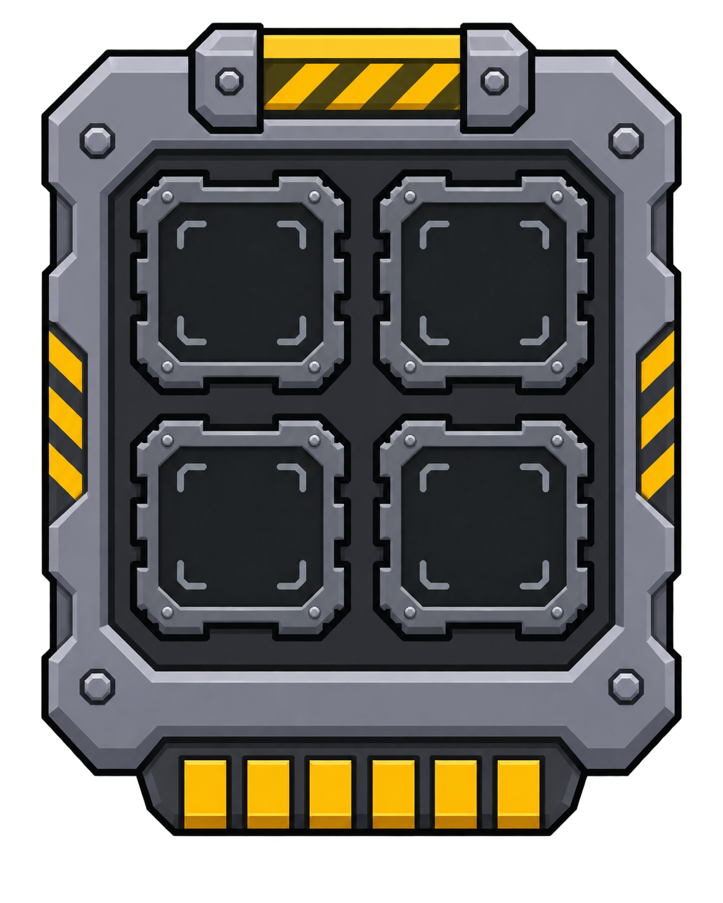
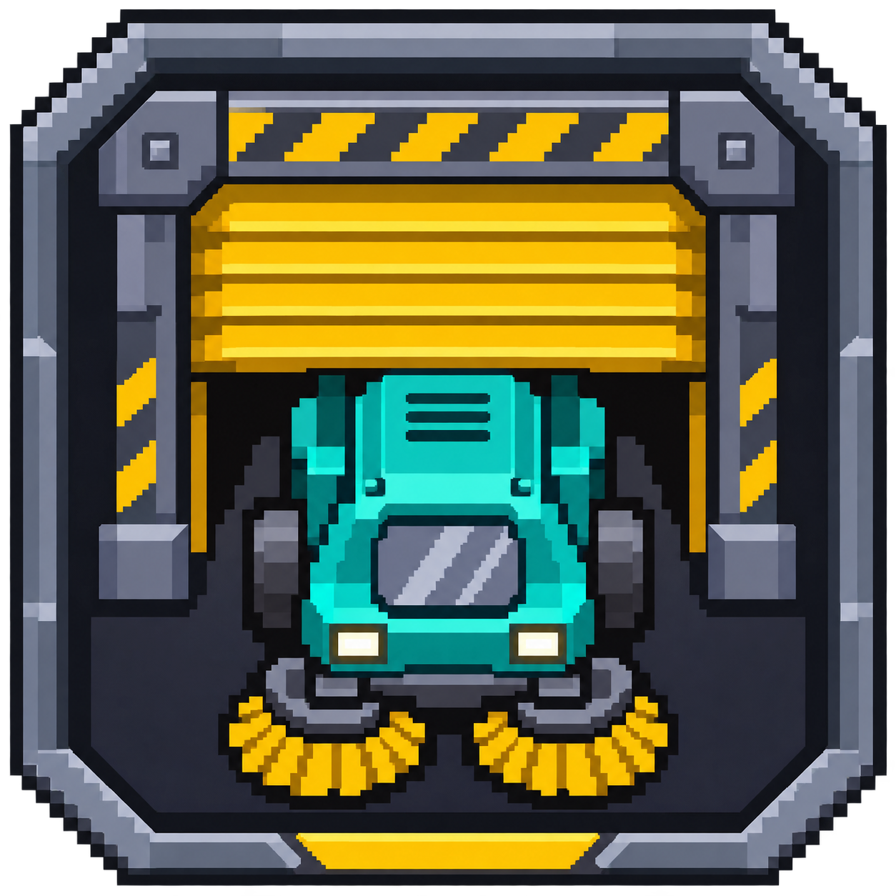
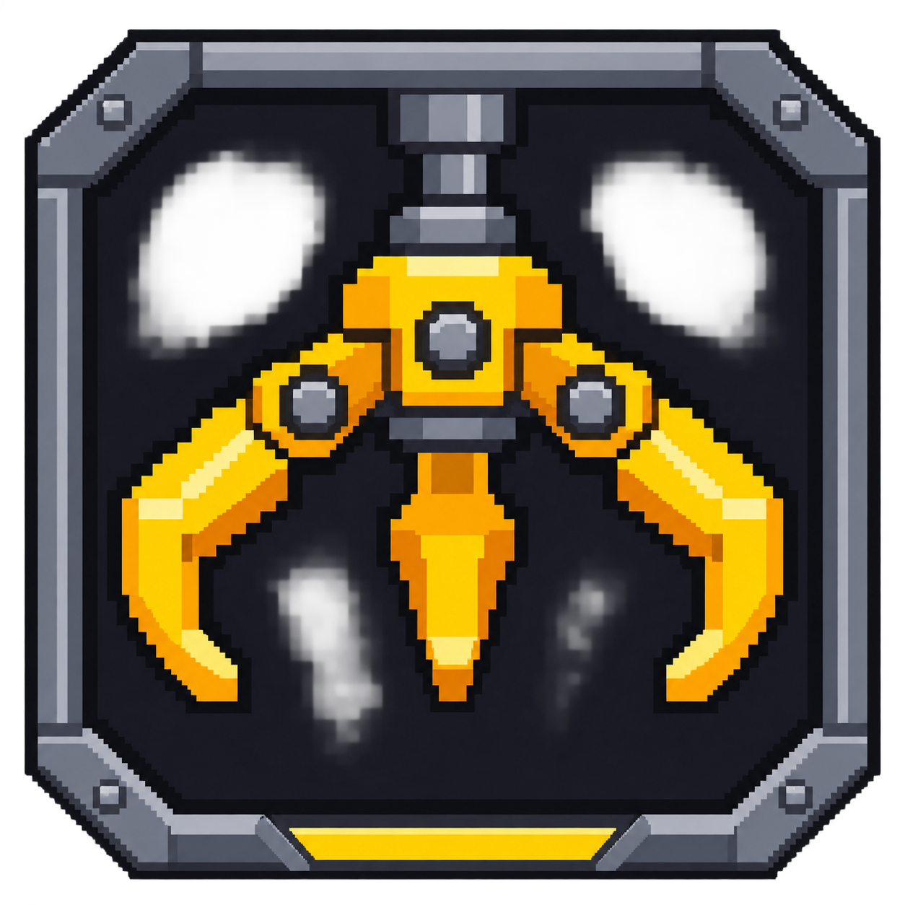

# 스킬 카트리지와 모듈

## 개발과 장착

전투에서 적을 처치하거나 청소 로봇을 회수해 고철을 얻는다. 강화 구역에서 고철을 써서 원하는 스킬의 모듈을 개발하고 해당 스킬의 카트리지에 장착한다. 고철은 압축 큐브와 지뢰 제작에도 쓰인다.

에테르 챔버 미니게임의 카트리지와 슬롯 구조를 참고한다. 스킬 7개에는 각자 전용 카트리지 1개가 있고, 카트리지마다 슬롯은 4칸이다. 모듈 하나가 슬롯 한 칸을 차지하며 해당 스킬에만 적용된다. 같은 유형은 카트리지당 하나만 장착할 수 있다. 서로 다른 카트리지에는 같은 유형을 각각 장착할 수 있다.

| 유형 | 효과 |
| --- | --- |
| 데미지 | 해당 스킬의 피해량 증가 |
| 범위 | 해당 스킬의 효과 범위 증가 |
| 쿨타임 | 해당 스킬의 재사용 대기시간 감소 |
| 지속시간 | 해당 스킬의 효과 지속시간 증가 |
| 소모량 감소 | 해당 스킬이 발사하거나 제작할 때 쓰는 자원을 줄인다. 폐수 방출은 초당 게이지 소모량, 고철 압축과 압축 지뢰는 제작당 고철 소모량을 줄인다. |
| 소환체 체력 증가 | 해당 스킬로 소환한 아군의 최대 체력을 높인다. 청소 로봇 사출에 적용한다. |
| 전용 | 해당 스킬에 고유 효과를 추가하거나 동작을 변경 |

## 스킬별 전용 모듈

스킬마다 전용 모듈을 하나씩 둔다. 아래 효과는 기획 초안이다.

| 카트리지 | 전용 모듈 |
| --- | --- |
| 청소 로봇 사출 | **융합 세척기** — 두 번 사출한 청소 로봇이 만나면 더 강한 한 대로 합쳐진다. 융합 로봇은 적이 앞에 모이면 회전 솔로 여러 적을 동시에 세척 공격한다. |
| 오염 폐수 방출 | **잔류 오염** — 폐수가 지나간 자리에 잠깐 웅덩이가 남고, 밟은 적은 느려진다. |
| 집게팔 | **연쇄 충돌** — 던진 적에 맞은 적이 밀려나며, 밀려난 적도 다른 적을 넘어뜨릴 수 있다. |
| 고철 압축 | **고철 흡수** — 큐브를 압축할 때 본체 주변의 고철을 끌어당겨 회수한다. 제작에 필요한 고철은 먼저 확보해야 한다. |
| 압축 지뢰 | **예약 기폭** — 설치한 지뢰를 스킬 키로 다시 눌러 터뜨릴 수 있다. 접촉하면 자동으로 폭발한다. |
| 청소 가속화 | **긴급 회수** — 가속 중 로봇을 회수하면 돌아오는 경로의 고철을 수거한다. |
| 오버클럭 | **비상 배기** — 강화가 끝날 때 굴뚝에서 증기를 뿜어 주변의 작은 적을 밀어낸다. |

스킬별 기본 모듈 적용 범위, 강화 수치, 개발 비용, 장착 후 교체 규칙은 미정이다. 폐수 방출은 [전용 게이지](./폐수-게이지.md)를 쓰므로 쿨타임 모듈의 적용 방식도 추후 정한다.

## 원본 참고 파일

[에테르 챔버 카트리지 관련 원본 ZIP](./aether-cartridge-reference.zip)에 보상 UI, 카트리지 상태, 관련 스타일과 아이콘을 담았다. 일부 소스는 에테르 챔버의 다른 기능과 공유되며 ZIP의 단독 실행은 확인하지 않았다.

## 모듈 아이콘 시트

각 줄은 왼쪽부터 읽는다.

| 줄 | 아이콘 순서 |
| --- | --- |
| 1 | 데미지 · 범위 · 쿨타임 · 지속시간 · 소모량 감소 |
| 2 | 소환체 체력 증가 · 융합 세척기 · 잔류 오염 · 연쇄 충돌 · 고철 흡수 |
| 3 | 예약 기폭 · 긴급 회수 · 비상 배기 |

이미지는 아이콘 13개를 한 장에 담은 초안이다.

## 메인보드와 카트리지 디자인 예시

왼쪽 메인보드에는 스킬별 카트리지 7개를 꽂는다. 오른쪽 확대안에는 모듈 슬롯 4칸이 있으며, 위의 두 칸에는 데미지와 범위 모듈을 장착하고 아래의 두 칸은 비워 뒀다.

### 개별 이미지

메인보드는 위에 4개, 아래에 3개의 카트리지 장착부가 있다.

카트리지에는 빈 모듈 슬롯 4칸이 2×2로 배치되어 있다.

## 기본 스킬 아이콘

| 스킬 | 미리보기 | 파일 |
| --- | --- | --- |
| 청소 로봇 사출 |  | `cleaner-launch.png` |
| 오염 폐수 방출 |  | `wastewater.png` |
| 집게팔 |  | `claw.png` |
| 고철 압축 |  | `scrap-compaction.png` |
| 압축 지뢰 |  | `scrap-mine.png` |
| 청소 가속화 |  | `cleaning-boost.png` |
| 오버클럭 |  | `overclock.png` |
