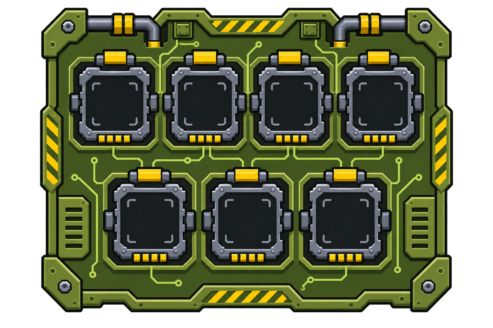
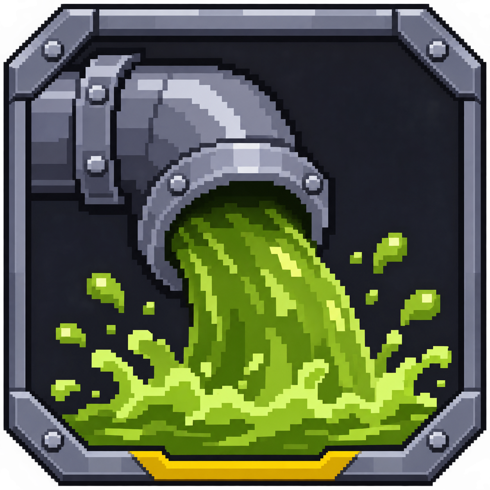
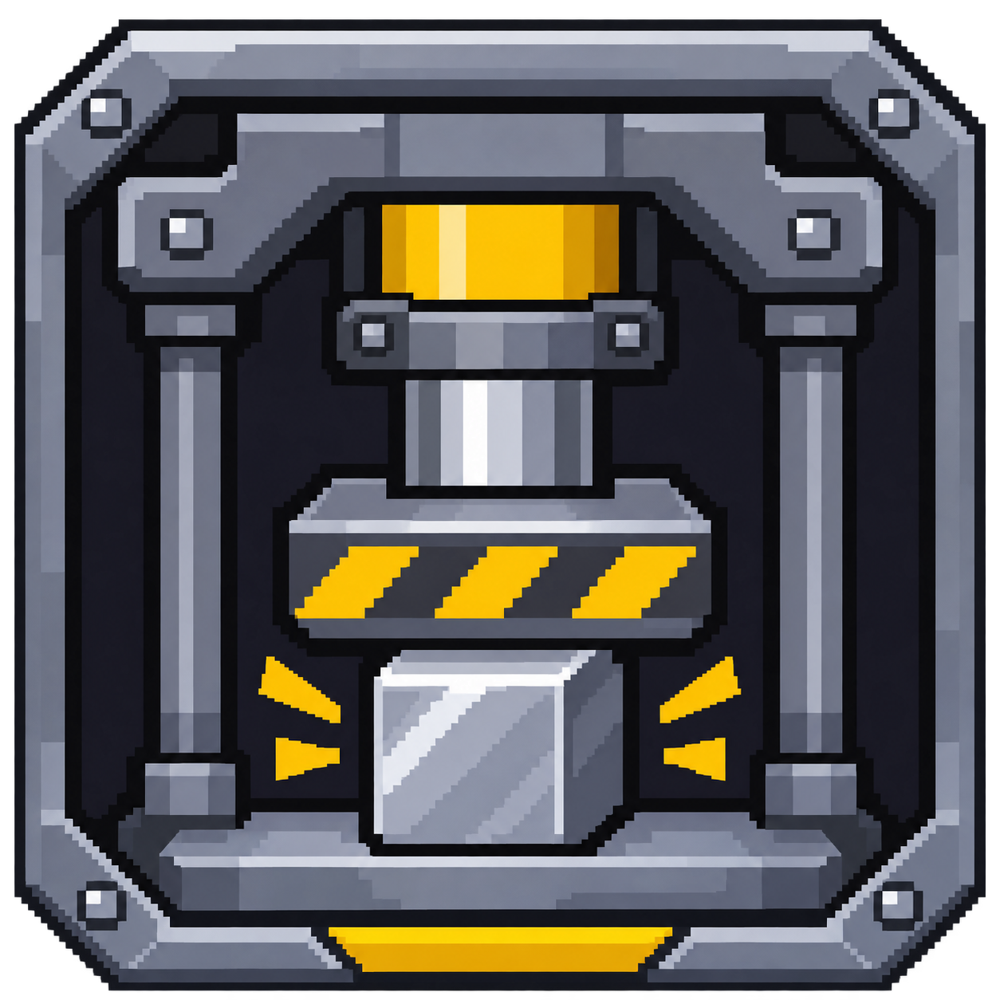
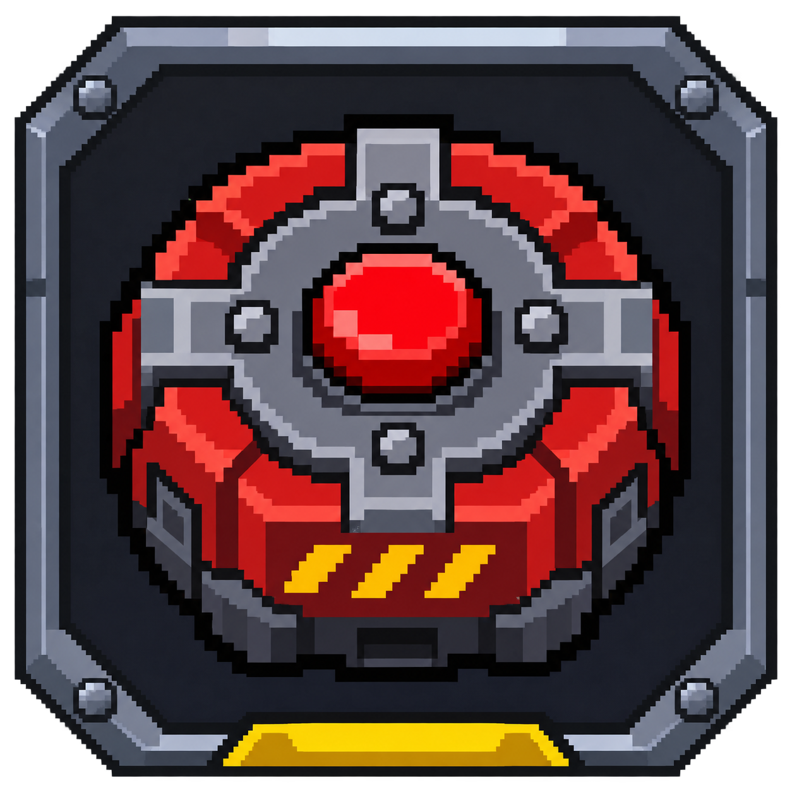
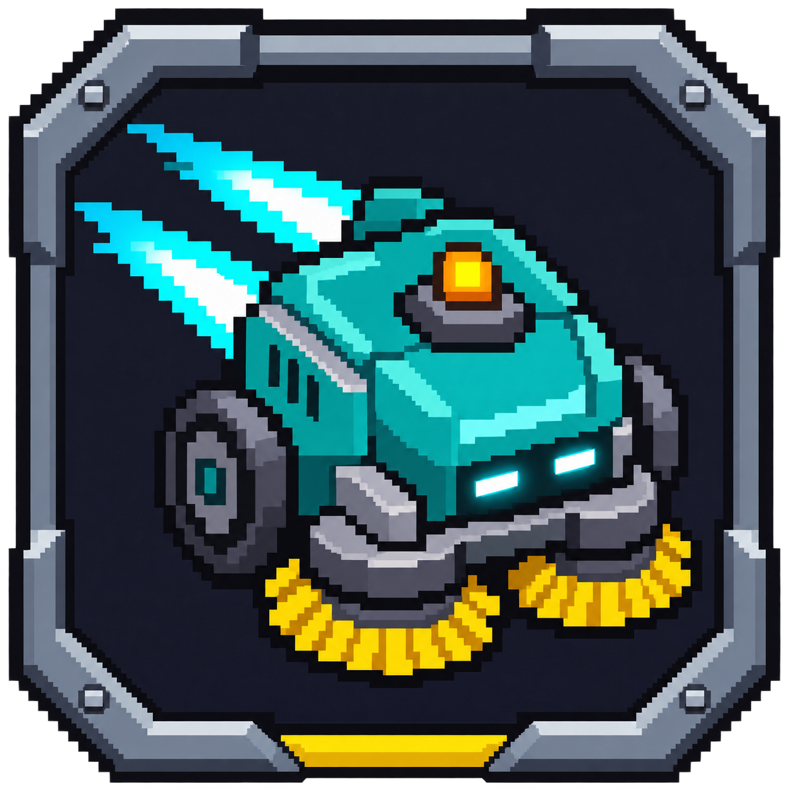
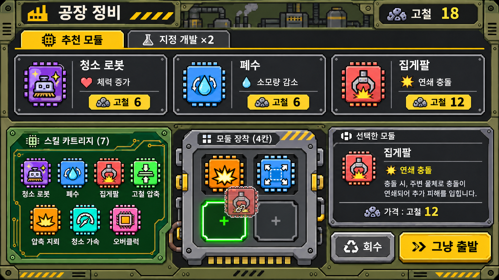
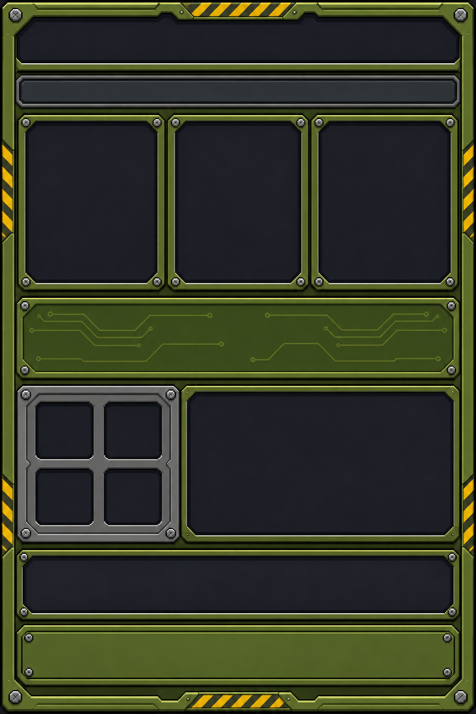

# 스킬 카트리지와 모듈

이 문서는 카트리지 시스템의 목표 사양이다. 아래 규칙과 수치는 재구현할 때 적용한다. 현재 게임 코드의 구현 상태와는 차이가 있을 수 있다.

## 개발과 장착

기본 스킬 7개와 전용 카트리지 7개는 새 판부터 사용할 수 있다. 카트리지당 슬롯은 4칸이며 모듈 하나가 한 칸을 사용한다. 같은 카트리지에는 같은 유형을 하나만 장착한다. 서로 다른 카트리지는 같은 유형을 각각 사용할 수 있다. 모듈 효과는 해당 스킬에만 적용된다.

전투와 사건에서 얻은 고철로 강화 구역에서 모듈을 개발한다. 청소 로봇이 운반하는 고철은 회수한 뒤 사용할 수 있다. 개발하면 선택한 스킬의 빈칸에 즉시 장착한다. 별도 보관함은 없다.

기본 모듈은 고철 6개, 전용 모듈은 12개다. 강화 구역에서 제거하면 실제 지불한 비용의 절반을 내림해서 반환한다. 교체는 제거 후 새 모듈을 개발하는 방식이다. 모듈 등급과 반복 강화 단계는 없다.

새 판은 모든 슬롯이 빈 상태로 시작한다. 구역을 넘어가면 모듈과 고철이 유지되고, 사망 또는 최종 보스 격파로 판이 끝나면 초기화한다. 누적 클리어 횟수는 유지한다.

## 일반 모듈 11종

기존 스킬 쿨타임 감소 유형의 이름을 스킬 스킬 쿨타임 감소 감소로 통일하고, 소환체 이동속도, 운반량, 밀쳐내기, 감속, 보호막을 추가한다. 각 유형은 슬롯 한 칸을 사용한다.

| 유형 | 효과 |
| --- | --- |
| 데미지 | 적용 공격의 피해량 ×1.35 |
| 범위 | 적용 거리와 반경 ×1.30 |
| 스킬 쿨타임 감소 | 재사용 대기시간 ×0.70. 폐수는 완충 시간 3.5초 → 2.45초 |
| 지속시간 | 적용 효과의 유지 시간 ×1.40 |
| 소모량 감소 | 폐수 게이지 또는 큐브·지뢰 제작 고철 소모 ×0.70 |
| 소환체 체력 증가 | 청소 로봇 최대 체력 ×1.60 |
| 소환체 이동속도 | 청소 로봇의 전투·수거·회수 이동속도 ×1.25 |
| 운반량 | 청소 로봇 고철 운반 한도 +3개 |
| 밀쳐내기 | 해당 공격이 발생시키는 밀림 거리 ×1.50 |
| 감속 | 집게팔 충돌 또는 지뢰 폭발에 맞은 적의 이동속도를 2초간 25% 감소 |
| 보호막 | 오버클럭 발동 시 본체 기본 최대 체력의 15%만큼 보호막 생성. 강화 종료 시 소멸 |

감속은 피해를 입은 적에게 적용하며 보스도 적용한다. 반복해서 맞으면 2초로 갱신하고 감속률은 누적하지 않는다. 여러 감속이 겹치면 가장 강한 하나를 적용한다. 보호막은 체력보다 먼저 피해를 흡수하며 중복해서 쌓이지 않는다. 밀쳐내기 면역인 보스는 면역을 유지한다.

## 스킬별 제공 유형

아래 유형에 각 스킬의 전용 모듈을 더해 개발 목록을 구성한다. 모든 유형을 모든 스킬에 제공하지 않는다.

| 카트리지 | 일반 모듈 | 적용 대상 |
| --- | --- | --- |
| 청소 로봇 사출 | 데미지, 범위, 스킬 쿨타임 감소, 소환체 체력 증가, 소환체 이동속도, 운반량 | 공격 피해, 탐색·공격 범위, 사출 대기시간, 로봇 체력, 이동속도, 운반 한도 |
| 오염 폐수 방출 | 데미지, 범위, 스킬 쿨타임 감소, 소모량 감소, 밀쳐내기 | 초당 피해, 물줄기 길이·폭, 충전 시간, 초당 게이지 소모, 물줄기의 밀림 거리 |
| 집게팔 | 데미지, 범위, 스킬 쿨타임 감소, 지속시간, 밀쳐내기, 감속 | 투척 충돌 피해, 잡기 거리·충돌 반경, 재사용 대기시간, 충돌 기절 시간, 충돌 밀림 거리, 충돌 감속 |
| 고철 압축 | 데미지, 스킬 쿨타임 감소, 지속시간, 소모량 감소 | 큐브 투척 피해, 제작 대기시간, 큐브 유지 시간, 제작 고철 |
| 압축 지뢰 | 데미지, 범위, 스킬 쿨타임 감소, 소모량 감소, 감속 | 폭발 피해, 폭발 반경, 설치 대기시간, 제작 고철, 폭발 감속 |
| 청소 가속화 | 데미지, 스킬 쿨타임 감소, 지속시간, 소환체 이동속도 | 가속 중 로봇 피해, 재사용 대기시간, 가속 유지 시간, 가속 중 로봇 이동속도 |
| 오버클럭 | 스킬 쿨타임 감소, 지속시간, 보호막 | 재사용 대기시간, 강화 유지 시간, 발동 보호막 |

고철 소모는 계산 후 올림한다. 예를 들어 5개 ×0.70은 4개다. 소모량 감소는 모듈 개발 비용에는 적용하지 않는다. 폐수는 기본 완충량으로 3초 발사하고 소모량 감소 장착 시 약 4.3초 발사한다. 지속시간은 큐브 체력이나 오버클럭 종료 후 출력 저하 3초를 바꾸지 않는다.

## 전용 모듈 7종

| 카트리지 | 전용 모듈과 동작 |
| --- | --- |
| 청소 로봇 사출 | **융합 세척기** — 기본 로봇 두 대의 몸체가 닿으면 융합한다. 공격력은 기본의 2배, 최대 체력과 현재 체력 및 운반 고철은 두 대의 합이다. 운반 한도도 합산한다. 추가 융합은 불가하고 소환 한도에서 두 대로 센다. 적이 앞에 2대 이상 모이면 0.6초 간격으로 회전 솔 광역 공격을 한다. 반경은 기본 공격 범위의 2배, 피해는 기본 공격 1회와 같다. |
| 오염 폐수 방출 | **잔류 오염** — 물줄기가 닿은 바닥에 2.5초간 웅덩이가 남는다. 밟은 적의 이동속도는 50% 감소한다. 웅덩이는 서로 피해나 감속을 중첩하지 않는다. |
| 집게팔 | **연쇄 충돌** — 던진 적에 맞은 적도 밀려나 추가 충돌을 일으킨다. 최초 충돌 뒤 최대 두 번 이어지고, 각 피해는 직전의 60%다. 같은 투척에서 같은 적을 중복 타격하지 않는다. 보스는 피해만 받는다. |
| 고철 압축 | **고철 흡수** — 큐브 제작 성공 시 평소 본체 줍기 반경의 3배 안에 있는 고철을 흡수한다. 제작 비용을 먼저 지불해야 한다. |
| 압축 지뢰 | **예약 기폭** — 설치 키를 0.4초 미만 누르면 놓을 때 설치하고, 0.4초 이상 누르면 설치된 지뢰를 모두 기폭한다. 길게 누르면 새 지뢰를 설치하지 않는다. 접촉 기폭도 유지한다. |
| 청소 가속화 | **긴급 회수** — 가속 중 회수를 명령한 로봇이 귀환 경로의 고철을 수거한다. 가속이 끝나도 귀환 완료까지 적용한다. 기존 운반 한도를 따르고 초과 고철은 바닥에 남는다. |
| 오버클럭 | **비상 배기** — 강화 종료 시 본체 줍기 반경의 2배 안에 있는 소형 적을 범위 밖으로 밀어내고 1초 기절시킨다. 이후 출력 저하가 시작된다. |

데미지·범위 모듈은 융합 로봇의 회전 솔에도 적용한다. 스킬 쿨타임 감소 모듈은 로봇의 기본 공격과 회전 솔의 공격 간격을 바꾸지 않는다. 폐수 범위 모듈은 웅덩이 반경에도 적용한다. 일반 감속 모듈과 잔류 오염이 겹치면 강한 감속을 적용한다.

## 계산과 적용 시점

서로 다른 출처의 배율은 곱한다. 청소 로봇과 청소 가속화의 데미지 모듈을 함께 쓰면 가속 중 피해는 기본 피해 ×1.35×1.35다. 항상 기본값과 현재 장착 목록으로 계산하며 장착·제거를 반복해도 수치가 누적되지 않는다.

로봇·큐브·지뢰는 생성될 때 해당 카트리지의 효과를 저장한다. 기존 개체는 개발·제거로 바뀌지 않고 새로 생성한 개체부터 적용한다. 가속화·오버클럭은 발동할 때 효과를 정한다. 폐수·집게팔은 사용할 때 현재 장착 효과를 적용한다. 제거 환급은 생성된 개체의 효과를 바꾸지 않는다.

융합 시 두 로봇의 강화 상태가 다르면 각 피해의 합을 융합 기본 공격 피해로 사용한다. 공격 간격은 두 간격의 평균, 이동속도는 두 속도의 평균, 탐색·공격 범위는 큰 값을 사용한다. 융합 시 중복 배율을 다시 곱하지 않는다.

## 화면과 조작

상단에는 제목과 고철 보유량, 그 아래 추천 모듈·지정 개발 탭과 모듈 선택지를 표시한다. 중단에는 가로로 긴 메인보드에 스킬 카트리지 7개를 배치한다. 하단 왼쪽에는 선택한 카트리지의 2×2 슬롯, 하단 오른쪽에는 마우스를 올린 모듈의 설명을 표시한다. 맨 아래에는 회수 영역과 그냥 출발 버튼을 둔다.

### 설명창

오른쪽 모듈 위에 마우스를 올리면 이름, 정확한 효과, 개발 가격과 적용 시점을 표시한다. 고철이 부족하거나 같은 유형을 이미 장착했으면 그 이유도 표시한다. 드래그 중에도 선택한 모듈의 설명과 가격을 고정된 위치에서 보여준다.

장착한 모듈 위에 마우스를 올리면 적용 효과와 제거 시 환급액을 표시한다. 가격과 환급액을 구분해서 표시한다.

### 개발과 드래그 장착

1. 왼쪽에서 스킬 카트리지를 선택한다.
2. 오른쪽 모듈을 빈 슬롯으로 드래그한다.
3. 장착 가능한 빈 슬롯은 초록색으로 강조한다.
4. 유효한 빈 슬롯에 놓으면 고철을 차감하고 그 슬롯에 즉시 개발·장착한다.
5. 슬롯 밖에 놓거나 취소하면 모듈을 원래 목록으로 돌려보내고 고철은 차감하지 않는다.

드래그를 시작할 때는 비용을 차감하지 않는다. 놓는 순간에도 고철 잔액, 빈 슬롯, 동일 유형 중복 여부와 대상 카트리지를 다시 확인한다. 조건을 만족하지 못하면 장착과 차감을 모두 취소하고 실패 이유를 보여준다. 고철 부족이나 중복 상태의 모듈에도 마우스를 올려 설명을 볼 수 있다.

슬롯 위치를 그대로 저장하며, 빈 슬롯이 중간에 있어도 유지한다. 다른 스킬의 슬롯에는 장착할 수 없다. 드래그 도중 카트리지를 바꾸거나 화면을 닫으면 드래그를 취소한다.

### 제거와 회수

장착된 모듈을 화면 아래 회수 영역으로 끌어다 놓으면 제거하고 실제 지불한 비용의 절반을 내림해서 돌려준다. 회수 영역에는 드래그 중인 모듈의 환급액을 표시한다. 영역 밖에 놓거나 취소하면 원래 슬롯으로 돌아간다. 목록에서 아직 개발하지 않은 모듈은 회수할 수 없다.

모듈 교체는 기존 모듈 회수 후 새 모듈 장착 순서로 진행한다. 장착된 모듈을 같은 카트리지의 빈 슬롯으로 옮기면 위치만 바뀌고 비용과 효과는 유지된다.

### 마우스 외 조작

터치에서는 모듈을 탭하면 설명과 가격이 열리고 드래그로 장착한다. 키보드에서는 모듈에 초점을 두면 설명이 열리며, 선택 후 빈 슬롯을 선택해 장착할 수 있다. 장착 모듈의 제거 동작도 키보드로 제공한다. 취소 입력은 비용을 소모하지 않는다.

정비 종료 후 경로 선택으로 돌아간다.

보스 격파 후에는 모듈 선택창을 연다. 첫 보스를 쓰러뜨린 시점부터 그 판의 전용 모듈 선택을 해금한다. 보스 보상도 기존 카트리지 슬롯과 중복 제한을 따른다. 별도 설비 칸과 고정 전리품 효과는 이전 제안이며 이번 규칙에 따라 재검토한다.
## 구현 완료 확인

- 새 판 초기화, 구역 간 유지, 승리·패배 후 초기화와 클리어 횟수 보존이 동작한다.
- 카트리지 4칸 제한, 같은 유형 중복 방지, 개발 비용과 제거 환급이 맞는다.
- 스킬별 개발 목록과 실제 효과가 일치한다.
- 폐수 충전·소모, 정수 고철 비용, 서로 다른 강화의 곱연산이 맞는다.
- 기존 개체와 신규 개체의 적용 시점, 융합 체력·운반 한도·소환 한도 계산이 맞는다.
- 모듈 설명창에 가격·효과·실패 이유가 보이고, 장착 모듈에는 환급액이 보인다.
- 드래그 성공 시 한 번만 결제되고, 실패·취소·화면 전환 시 결제되지 않는다.
- 지정한 슬롯 위치와 빈칸이 유지되고, 이동·회수 시 비용과 환급액이 맞는다.
- 마우스·터치·키보드로 장착과 제거를 수행하고 정비 종료 후 다음 경로로 진행할 수 있다.

## 원본 참고 파일

[에테르 챔버 카트리지 관련 원본 ZIP](./aether-cartridge-reference.zip)에 보상 UI, 카트리지 상태, 관련 스타일과 아이콘을 담았다. 일부 소스는 에테르 챔버의 다른 기능과 공유되며 ZIP의 단독 실행은 확인하지 않았다.

## 모듈 아이콘 시트


각 줄은 왼쪽부터 읽는다.

| 줄 | 아이콘 순서 |
| --- | --- |
| 1 | 데미지 · 범위 · 스킬 쿨타임 감소 · 지속시간 · 소모량 감소 |
| 2 | 소환체 체력 증가 · 융합 세척기 · 잔류 오염 · 연쇄 충돌 · 고철 흡수 |
| 3 | 예약 기폭 · 긴급 회수 · 비상 배기 |

이미지는 아이콘 13개를 한 장에 담은 초안이다.

## 메인보드와 카트리지 디자인 예시


왼쪽 메인보드에는 스킬별 카트리지 7개를 꽂는다. 오른쪽 확대안에는 모듈 슬롯 4칸이 있으며, 위의 두 칸에는 데미지와 범위 모듈을 장착하고 아래의 두 칸은 비워 뒀다.

### 개별 이미지



메인보드는 위에 4개, 아래에 3개의 카트리지 장착부가 있다.


카트리지에는 빈 모듈 슬롯 4칸이 2×2로 배치되어 있다.

## 기본 스킬 아이콘

| 스킬 | 미리보기 | 파일 |
| --- | --- | --- |
| 청소 로봇 사출 |  | `cleaner-launch.png` |
| 오염 폐수 방출 |  | `wastewater.png` |
| 집게팔 |  | `claw.png` |
| 고철 압축 |  | `scrap-compaction.png` |
| 압축 지뢰 |  | `scrap-mine.png` |
| 청소 가속화 |  | `cleaning-boost.png` |
| 오버클럭 |  | `overclock.png` |

## 공장 정비 단말기 화면 예시



이 이미지는 색상과 재질 참고용이다. 화면 배치는 아래 확정 배치도를 따른다. 글자와 버튼은 실제 UI 요소로 구현한다. 가운데는 집게팔 카트리지의 데미지·범위 모듈과 연쇄 충돌 모듈 장착 예시다.

### 획득 방식

- 추천 모듈 탭에는 서로 다른 모듈 3개를 제시한다. 각 선택지에 대상 스킬을 명시한다. 기본 가격은 일반 6개, 전용 12개이고 추천은 절반 가격(일반 3개, 전용 6개)으로 판다. (신율 결정, v0.18)
- 추천은 처음부터 달면 좋은 모듈(데미지 · 스킬 쿨타임 감소 · 범위, 집게팔 · 폐수 · 청소 로봇)이 더 자주 나온다. 첫 보스 격파 전에는 전용 모듈이 나오지 않는다. 첫 보스 격파 이후에는 전용 모듈을 추천 후보에 포함한다. 가중치는 `CONFIG.modules.recWeight` · `recSkill`.
- 지정 개발 탭에서는 원하는 스킬과 모듈을 고른다. 가격은 일반 12개, 전용 24개다.
- 한 강화 구역에서 둘 중 한 방법으로 모듈 하나를 획득하면 모듈 획득을 종료한다.
- 구매하지 않고 출발할 수 있다. 탭을 바꿔도 추천 3개는 유지된다.
- 같은 스킬에 이미 장착한 유형은 추천에서 제외한다. 슬롯이 가득 찼다면 기존 모듈 회수로 자리를 만들 수 있다.
- 슬롯에 성공적으로 놓을 때 결제한다. 실패하거나 취소하면 비용을 차감하지 않는다.
- 제거 환급은 실제 지불액의 절반이다. 지정 개발로 산 일반 모듈의 환급액은 6개, 전용 모듈은 12개다.

모듈 3개를 고르는 난수 규칙과 모든 선택지가 소진된 상황의 UI는 구현 시 명시한다.

## 확정 화면 배치

상단에서 하단으로 추천 선택지 → 가로 메인보드 → 선택 카트리지와 설명 순서로 배치한다. 사용자가 지정한 아래 구조를 구현 기준으로 삼는다.

```text
┌──────────────────────────────────────────────┐
│ 모듈 정비                         고철 18개  │
│                                              │
│ [추천 모듈]          [지정 개발 · 가격 2배]   │
│                                              │
│       [모듈 A]    [모듈 B]    [모듈 C]       │
│       적용 스킬   적용 스킬   적용 스킬      │
│       고철 6      고철 12     고철 6         │
│                                              │
│ ┌──────────── 메인보드 ────────────────────┐ │
│ │ 스킬 카트리지 7개                       │ │
│ └─────────────────────────────────────────┘ │
│                                              │
│ 선택한 카트리지       마우스를 올린 모듈 설명 │
│ ┌─────┬─────┐                                │
│ │ 모듈│ 빈칸│        효과와 가격              │
│ ├─────┼─────┤                                │
│ │ 빈칸│ 빈칸│                                │
│ └─────┴─────┘                                │
│ [회수 영역 · 환급액 표시]        [그냥 출발]   │
└──────────────────────────────────────────────┘
```

추천 모듈을 드래그하면 대상 카트리지가 강조된다. 대상 카트리지 위에 잠깐 머물면 하단에 해당 슬롯이 펼쳐진다. 빈 슬롯에 놓아 개발·장착한다. 지정 개발 탭에서도 메인보드와 슬롯·설명 위치를 유지한다. 드래그 중 설명은 하단 오른쪽에 고정한다.

## 세로형 정비 단말기 배치



세로형 화면은 위 배경을 사용한다. 기준 캔버스는 1024×1536이며 아래 좌표는 배경 안의 실제 UI 콘텐츠 영역이다. 좌표 원점은 왼쪽 위다. 화면을 줄일 때 배경과 UI를 같은 비율로 축소한다. 배경의 금속 테두리에 버튼이나 글자가 겹치지 않도록 각 영역 안쪽에 여백을 둔다.

| 영역 | 기준 좌표 x, y, 너비, 높이 | 배치할 내용 |
| --- | --- | --- |
| 제목 | 60, 55, 900, 75 | 왼쪽 모듈 정비, 오른쪽 고철 보유량 |
| 탭 | 55, 175, 915, 42 | 추천 모듈 / 지정 개발 · 가격 2배 |
| 추천 A | 65, 280, 260, 315 | 모듈 아이콘, 이름, 대상 스킬, 가격 |
| 추천 B | 380, 280, 260, 315 | 모듈 아이콘, 이름, 대상 스킬, 가격 |
| 추천 C | 690, 280, 260, 315 | 모듈 아이콘, 이름, 대상 스킬, 가격 |
| 메인보드 | 65, 660, 895, 130 | 스킬 카트리지 7개를 한 줄로 배치 |
| 카트리지 | 65, 855, 295, 285 | 선택한 스킬의 모듈 슬롯 4칸 |
| 설명창 | 420, 860, 535, 275 | 선택한 카트리지 이름, 마우스를 올린 모듈 이름·효과·가격·장착 가능 여부 |
| 회수 | 65, 1210, 890, 100 | 회수할 모듈을 놓는 영역. 드래그 중 환급액 표시 |
| 출발 | 65, 1375, 890, 65 | 그냥 출발 버튼 |

### 슬롯 위치

4칸은 각각 약 105×105 콘텐츠 영역으로 잡는다. 왼쪽 위 좌표는 순서대로 (88, 875), (235, 875), (88, 1018), (235, 1018)이다. 아이콘을 슬롯 중심에 맞추고 비율을 유지한다. 장착 가능 강조선은 배경에 그려진 슬롯 안쪽에 표시한다.

### 사용 흐름

1. 추천 탭은 모듈 3개를 보여준다. 카드에 대상 스킬과 가격은 항상 표시한다.
2. 모듈 위에 마우스를 올리거나 키보드 초점을 두면 하단 설명창에 정확한 효과와 가격을 표시한다.
3. 카드를 드래그하면 대상 스킬의 메인보드 버튼이 강조된다. 해당 버튼에 머물면 하단 카트리지가 그 스킬로 전환된다.
4. 하단의 유효한 빈 슬롯에 놓으면 결제·장착한다. 슬롯 밖에 놓으면 취소한다.
5. 장착 모듈을 회수 영역으로 옮기면 환급한다. 장착 모듈의 설명에는 환급액을 표시한다.
6. 지정 개발 탭에서는 위의 카드 영역을 사용해 선택한 스킬의 개발 목록을 스크롤해서 보여준다. 일반 모듈 12개·전용 모듈 24개의 실제 고철 가격을 표시한다.
7. 한 번 획득하면 추가 구매를 종료하고 출발 안내를 표시한다. 탭 전환으로 추천 선택지를 다시 뽑지 않는다.

배경은 장식 이미지이며 글자·아이콘·드래그 판정·버튼은 실제 UI 요소로 겹쳐 구현한다. 고정 비율 래퍼 안에서 퍼센트 좌표를 사용하고, 화면보다 높으면 세로 스크롤을 제공한다. 드래그 중 화면 가장자리에서는 자동 스크롤로 하단 슬롯까지 이동할 수 있게 한다. 터치에서는 카드 선택 후 빈 슬롯 탭으로도 장착할 수 있게 한다.
